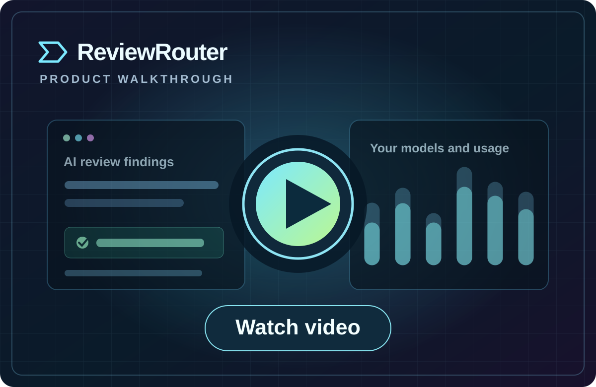
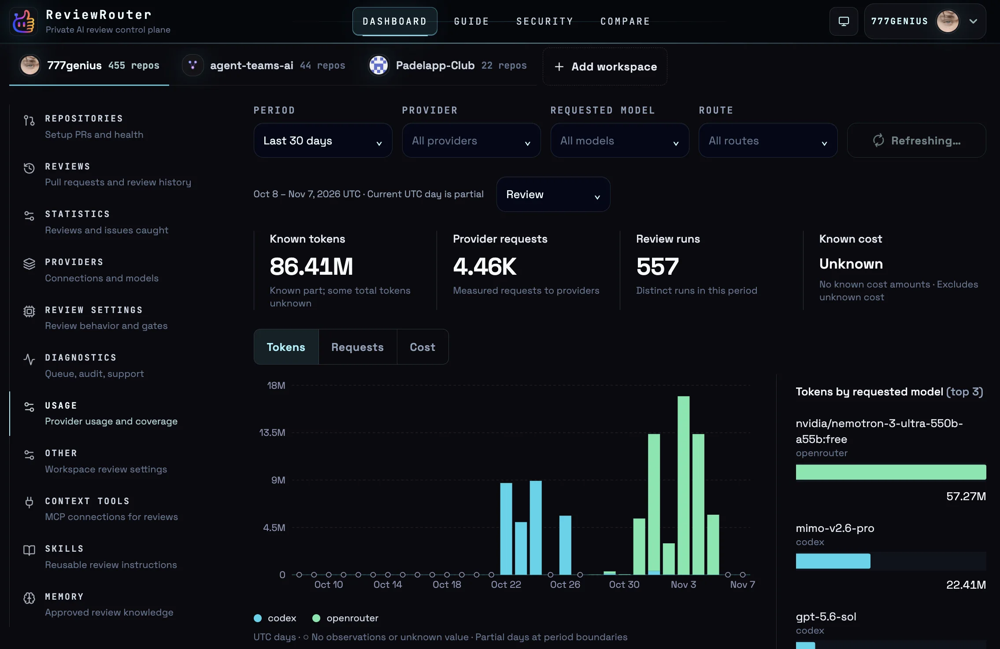
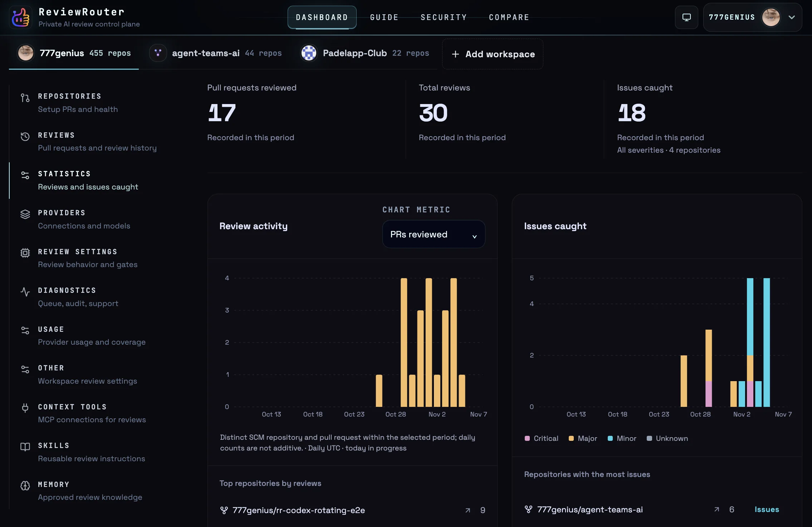
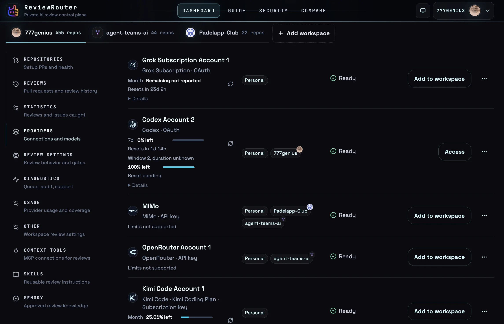
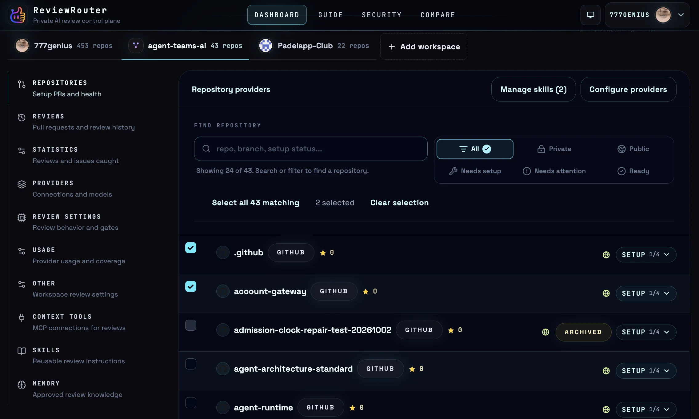
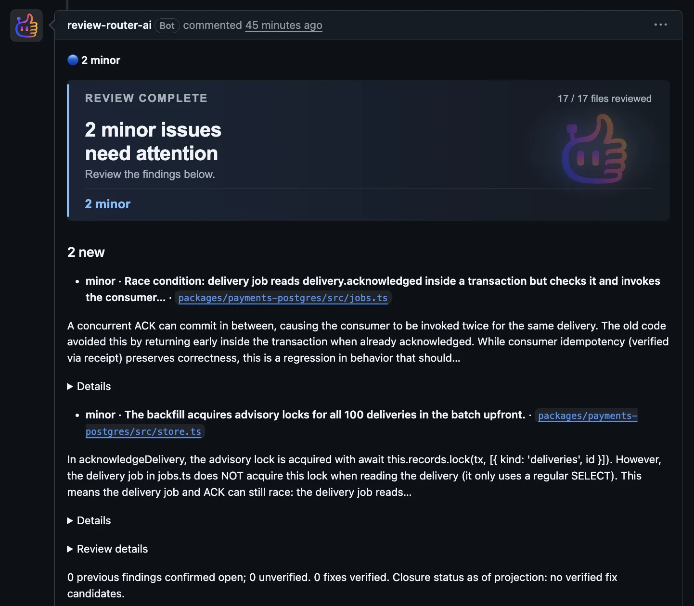

# ReviewRouter

AI code review for GitHub pull requests, powered by [OpenCodeReview](https://github.com/alibaba/open-code-review).
Run reviews in GitHub Actions with your own AI providers; manage findings, models
and review rules in one dashboard.

[Set up your reviewer now](https://reviewrouter.org) with a guided setup.

[Self-host](./docs/operations/review-router-self-hosted-end-to-end.md) · [Documentation](./docs/README.md)

## Dashboard preview

<p align="center">
  <a href="https://reviewrouter.org/" title="Watch video">
    
  </a>
  
</p>
<p align="center">
  
  
</p>
<p align="center">
  
  
</p>

## Features

### Memory, Skills and MCP

- **Memory (Hindsight).** Reuse approved workspace-, repository- and user-scoped
  rules, observations and exceptions when a memory backend is configured.
- **PR conversations.** On qualified interaction workflows, respond to inline
  review threads using the verified discussion. Authorized maintainer replies can
  also propose memory changes.
- **Memory controls.** Browse and add knowledge, retire outdated entries or
  request permanent forgetting. Workspace admins can require confirmation
  before AI memory changes.
- **Skills.** Create versioned Markdown review instructions, import/export
  `SKILL.md`, share across workspaces with permission and assign them to repositories.
  Each review captures its selected instructions.
- **Skills catalog.** Preview [Universal Agent Plugins](https://universal-agent-plugins.com/)
  skills, check static security results (optionally AI-assisted) and import
  reviewed text without installing third-party scripts.
- **MCP tools.** Connect remote HTTPS MCP servers, discover and approve tools,
  and select them for compatible reviews. Test Dashboard credentials in the UI;
  verify GitHub Secrets in the repository workflow. Built-in tools cover
  GitHub issues and docs.

### AI reviews

- **Inline code review.** Severity-rated, line-specific findings and summaries
  attached to the exact PR commit.
- **Multiple reviewers.** Choose models and accounts, run reviewers in parallel
  and require agreement before publishing inline findings.
- **AI providers and accounts.** Connect native Claude/Anthropic, Gemini,
  OpenAI/Codex, Grok, Kimi, GLM, MiniMax, DeepSeek, OpenRouter, NVIDIA Build
  and others through supported per-provider API keys, OAuth or imports.
  Availability depends on the deployment; see the matrix below.
- **Review settings.** Workspace defaults and per-repository overrides for models,
  reasoning effort, language, severity, comment limits and parallelism. Workspace
  admins also control automatic reviews of draft PRs.
- **PR descriptions.** Optionally generate or update descriptions with the
  configured primary reviewer.
- **Safe publication.** Stale runs cannot publish findings for newer code.
  Failed or incomplete review coverage is reported, not counted as success.

### Dashboard and insights

- **Review history.** Search pull requests by title, number or repository;
  filter by status and date, inspect previous runs and reruns, and open the GitHub PR.
- **Statistics.** Published reviews, distinct PRs and first-recorded issues by
  severity, with trends, top repositories and 7/30/90-day comparisons. Drill into
  individual findings and open their PRs.
- **Usage.** Provider attempts, known tokens and costs by provider, model
  and run, with filters and explicit coverage when data is missing.
- **Operations.** Repository health, queue failures, audit events,
  metadata-only diagnostics and workspace/repository access management.

### Setup and hosting

- **GitHub App setup.** Select repositories, create an inspectable setup PR
  for workflow changes and verify readiness in the dashboard.
- **AI finding discussions.** New qualified rotating Codex workflows enable
  suggest-only replies for the same-repository PR author by default; other
  commenters do not trigger paid AI discussion. Qualified managed Gateway
  workflows have an independent default. Opt out with repository variable
  `REVIEW_ROUTER_DISCUSSION_MODE=off`. Unsupported providers remain disabled,
  and earlier installed workflows change only after an approved setup PR.
- **Organization-wide checks.** In eligible GitHub organizations, configure a
  shared required workflow through GitHub Rulesets for selected or all repos.
  Requires a supported GitHub plan and organization permissions.
- **Code and credentials.** By default, checkout and tools run in GitHub Actions,
  repository credentials stay in CI, and the chosen AI provider receives review
  context. ReviewRouter stores results and operational metadata, not raw source files.
- **Hosting options.** Use the hosted service or
  [self-host with the guided Docker Compose installer](./docs/operations/review-router-self-hosted-end-to-end.md).

Availability varies by provider, installed workflows and deployment. See
[capabilities and limits](./docs/capabilities.md).

## Supported AI providers

Choose a supported subscription or bring an API key. The ways to connect
depend on the provider and on your deployment.

| Provider | Ways to connect |
| --- | --- |
| **Claude / Anthropic** | API key, account sign-in (OAuth), session-assisted sign-in, setup token |
| **Claude via AWS / Google Cloud** | Bedrock API key or AWS credentials; Vertex AI service account |
| **Gemini / Google** | API key, Google One / Code Assist / AI Studio sign-in, Vertex AI credentials |
| **OpenAI / Codex** | OpenAI API key; Codex sign-in, token / session import, `auth.json`, Agent Identity, PAT |
| **Grok / Antigravity** | Account sign-in, imported token, API key where supported; Grok SSO |
| **Kimi / GLM / MiniMax** | API keys for pay-as-you-go or supported coding/subscription plans |
| **DeepSeek / OpenCode Go and Zen / Command Code / Cline** | API key |
| **OpenRouter / NVIDIA Build** | API key |
| **MiMo Token Plan** | Token Plan API key (existing ReviewRouter connection) |

**Important:** Not all options are enabled in every deployment, and not all
managed-account methods work as direct GitHub Actions secrets. See the
[full provider-by-provider table](./docs/provider-connections.md) or the
[public providers page](https://reviewrouter.org/providers) for exact methods
and requirements. Our controlled integration tests do not substitute for a
live paid-provider review.

## PR comment commands

With the **ReviewRouter Interaction** workflow installed, `/rr help`, `/rr status`
and `/rr review` work in the PR conversation; replies to a ReviewRouter
inline finding can use `/rr skip`, `/rr unskip`, `/rr explain`, `/rr fixed`
and `/rr suggest fix`.

- `/rr fixed` checks **one** existing finding against the current HEAD and
  reports whether it is fixed, still present or cannot be verified.
- `/rr suggest fix` may produce **one human-applied GitHub code suggestion**
  for a verified current changed line; it does not commit, push or resolve threads.

These two focused commands require a qualified managed Conversation Gateway,
an authorized repository maintainer, a same-repository PR and a direct reply
to the original verified inline finding. Publishing focused replies also
requires an eligible managed interaction caller with effective `discussion_mode: suggest`.
Qualified managed Gateway callers default to `suggest`; older reusable callers
can still default to `off` until configured. Repository variable
`REVIEW_ROUTER_DISCUSSION_MODE=off` disables published replies.
Provider and workflow availability vary; some standalone Action installs only
listen to inline review replies.
See the [complete command reference](https://github.com/777genius/review-router#pr-comment-commands)
for all supported commands, permissions, Memory options and limitations.

## Start with GitHub

1. [Install the GitHub App](https://reviewrouter.org) and select repositories.
2. Create and merge the review setup PR from the dashboard.
3. Connect a supported AI provider and open a pull request.

You approve the workflow changes before reviews begin. Provider usage counts
against your own subscription or API billing.

## Self-host

**Agent-first is the default.** On a Linux x64 server, prepare Docker
Compose v2, Git, curl, and Node.js 24.21+ or 26.10+. Point two DNS names
(e.g., `review.example.com` and `api.review.example.com`) to the server
and allow inbound ports 80/443. Default Memory also requires Python 3 and tar.

Give your coding agent shell access to that server and run:

```bash
bash -c 'installer=$(mktemp) && curl -fsSL https://raw.githubusercontent.com/777genius/review-router-ai/main/scripts/install-self-hosted.sh -o "$installer" && bash "$installer" "$@"; result=$?; rm -f "$installer"; exit "$result"' -- \
  --web-url https://review.example.com \
  --repo OWNER/REPOSITORY
```

Replace the example domain and repository. The API domain defaults to
`https://api.review.example.com`; configure its DNS record too.
The installer generates private credentials, starts services and HTTPS,
and returns **one JSON status** with the next action. It resumes without
rebuilding a healthy installation. Agent mode needs no interactive terminal;
to follow prompts yourself, add `--interactive` to the same command.

You still approve the GitHub App, connect the provider through **GitHub Secrets**,
and approve the workflow setup PR. In `--review-only` mode, install the canonical
workflow manually instead. Subscription-account Gateway is a separate service.
A running server is **not** proof of a completed AI review.

This moving-branch command is for evaluation. For production,
[pin an approved source commit](./docs/operations/review-router-self-hosted-end-to-end.md#agent-first-installation-default).
See [installation, resume and first-review steps](./docs/operations/review-router-self-hosted-end-to-end.md#guided-installation).

## Review engine

ReviewRouter uses [OpenCodeReview](https://github.com/alibaba/open-code-review).
Its [published benchmarks](https://github.com/alibaba/open-code-review#benchmark)
are upstream results, not independent ReviewRouter measurements.

## Current status

| Integration | What to expect                                                     |
| ----------- | ------------------------------------------------------------------ |
| GitHub      | App installation, setup PRs, inline review and a shared dashboard. |
| GitLab      | In development.                                                    |
| Self-hosted | Guided Docker Compose installation on your infrastructure.         |

ReviewRouter keeps a live progress comment on the pull request while a review
runs, on by default. See [capabilities and limits](./docs/capabilities.md) for
availability, the review runtime boundaries and privacy details.

## Learn more

- [Self-hosting guide](./docs/operations/review-router-self-hosted-end-to-end.md)
- [Review settings](./docs/review-settings.md)
- [Development and checks](./docs/development.md)
- [All documentation](./docs/README.md)

This repository contains the dashboard, API, worker and review orchestration.
The public GitHub Action entrypoint lives in
[777genius/review-router](https://github.com/777genius/review-router).

## Licensing

ReviewRouter original contributions are distributed under [Apache License 2.0](LICENSE). It uses [OpenCodeReview](https://github.com/alibaba/open-code-review) (also Apache-2.0); third-party components keep their separate notices. See [`NOTICE`](NOTICE), the bundled font license and the action's third-party license inventory.
