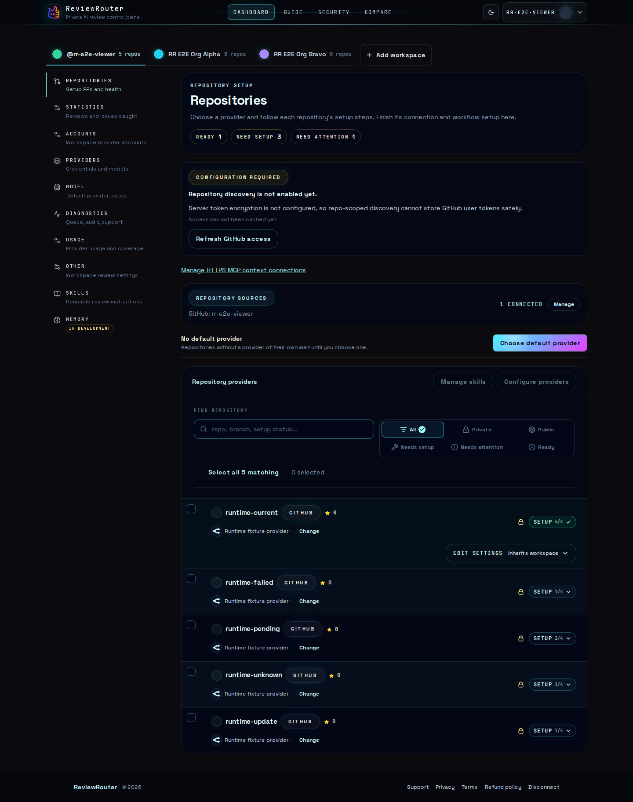
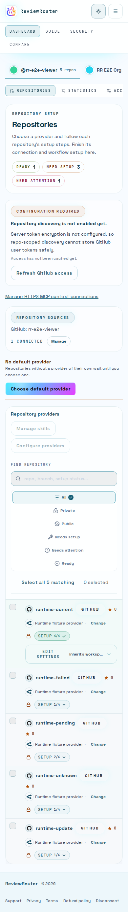

# Unified OCR review: implementation and acceptance

Status updated 2026-10-29: both main integrations and the source/contract/bundle
handoff are committed in the existing draft PRs. Local controlled qualification
is green in the distinct scopes below. Full GitHub CI on published **M/A** remains **pending**. Source implementation
reviews and the final documentation critic recheck returned GO; both P2 wording
findings are closed. Live provider/GitHub
qualification, release publication and deployment remain separate gates.

- Control plane: <https://github.com/777genius/review-router-ai/pull/718>
- Public Action: <https://github.com/777genius/review-router/pull/346>
- [Current integration identities/status](2026-10-29-unified-ocr-integration-status.md)
- [Completion plan and review record](../plans/2026-10-29-unified-ocr-completion.md)
- [Original implementation plan](../plans/2026-10-26-unified-ocr-review.md)

## Current candidate and qualification scopes

Canonical export/wrapper source **S** is
`dccf5b628680bd7f3f8c9501e3108e432053495b`; public Action **A** is
`cfe2b78fba925e3e7741d8c7f479324aa785d12b`; SaaS Action-pin ancestor **P**
is `ff033fd0056e84f522c2b62799a48c56e5613cbd`. Format-only descendant **F**
`eb937dcc2c087f5115894b6279b9f2ab38049e83` preserved 77 protected runtime
files byte-for-byte. **A** retains canonical provenance from **S**; neither
**F** nor **P** is represented as a new export source.

Published SaaS merge **M** `841f44f0900409692559286cdbb00ac319a40664` joins current main
`8ea78b9...` through exactly eight test/docs paths. The shared harness retains both History source coverage and native OCR
admission; resolved-diff review returned GO and all 77 protected files/Action pin
remain unchanged. Focused types/lint/format and three selected existing PG cases
passed, with 11 cases intentionally filtered. Earlier 25/UI results retain their
pre-join scope; this is not another full matrix or browser pass. Final CI must
qualify the merge descendant of **P** with unchanged **A/S**.

| Check                                         | Observed result                          | Exact scope and limitation                                                                                                                                                                                                                                                                                                                                     |
| --------------------------------------------- | ---------------------------------------- | -------------------------------------------------------------------------------------------------------------------------------------------------------------------------------------------------------------------------------------------------------------------------------------------------------------------------------------------------------------- |
| Shared lifecycle and all finite runner routes | **24/24** in one serial run              | Original 18 cases retained: 17 shared protocol/fault cases plus the actual Gateway runner. Six additional actual runner cases cover OpenRouter, MiMo, Kimi, repository Codex, Hosted Codex and Claude.                                                                                                                                                         |
| Three-head comparison publication             | **1/1** in that same run                 | Production signed writer witness, actual PostgreSQL history activation, App worker, receipts and one eligible resolution; no publication gate bypass. Together with the preceding row, this is **25/25**, 0 failures/skips, 246.97 seconds.                                                                                                                    |
| Isolated reviewer P2 setup cleanup            | **1/1** subsequent comparison rerun      | Harness creation moved under cleanup ownership so setup failure closes the witness. This overlaps the comparison case; it is not a 26th unique test.                                                                                                                                                                                                           |
| Actual Next and visual inspection             | **2/2**, six captures, **Sol visual GO** | Exact UI source `b0239454bf5cad4ef61419d425f302efb231e244`, desktop/mobile, both themes. Database was a schema-only restored checked source roster, not fresh-migration evidence. These UI files remain in **S**.                                                                                                                                              |
| Actual production bundle                      | **3/3**                                  | Latest rerun executes committed `f0067f4...` `dist/index.js` bytes with a Git-HEAD-blob identity check: long/short/expired rotated auth, decrypted synthetic sealed writeback, no checkout/runner/model entry for insufficient lifetime. CI-only delivery correction leaves all ten runtime hashes unchanged. This overlaps the earlier pre-commit 3-case run. |
| Official auth helper                          | **1/1**, separate earlier run            | Pinned official Codex 0.147.0 under the existing isolated loopback OAuth fixture; helper/bootstrap unchanged by final handoff. No model thread/turn, real subscription or full remote workflow proof.                                                                                                                                                          |
| Final **M/A** GitHub CI                       | **Pending**                              | Local source, UI and executable receipts do not replace final-pair CI. Record the actual result before closing implementation acceptance.                                                                                                                                                                                                                      |

Each of the seven real runner cases publishes findings on head A. Head B
verifies two fixes, retains the active finding and unprovable finding, publishes
a new issue and resolves only the eligible fixes. Discovery and the common
verifier share the original route/model and durable allowance; completed replay
restores the same authorization/execution/artifact without new provider or
GitHub effects. Hosted checks its real native grant/request/effect ledgers,
original account and zero failover. Gateway verifies a saved model outside the
enrollment anchor. Provider, credential-session, GitHub and OIDC observations
are controlled synthetic boundaries; the OCR executable, Git revisions,
admission, database, verifier, worker and receipts are real implementations.

The new routes exposed and qualified a production admission correction: ordinary
native/direct deadlines retain their original millisecond maximum through the
first capture and exact admission recapture; Gateway retains its existing
whole-second bound. No deadline, allowance or identity was extended, and the
snapshot equality fence remains strict.

The first complete local attempt hit PostgreSQL ENOSPC during reset; its failed
log/JSON were retained separately. After reproducible cache cleanup, the serial
25-case retry above passed. Local receipt labels are
`paired-completion-source-retry1-result.json` (SHA-256
`d4e945adc190ec02c01b6d76dc626152a7cb64c6f172ce71ccebe8534a331a55`)
and `paired-comparison-cleanup-result.json`. They are source qualification
receipts, not hosted CI artifacts or deployment evidence.

### Immutable combined OCR candidate

- Profile/version: **`ocr-managed-v5` / `1.13.1-rr.6`**.
- Binary SHA-256: `9dd5f115747d24100f0767133a3288d268f3bc399675f5b826e7a867d101ee5c`.
- Pinned upstream: `8eb83340a487b1150af00701b94f01af97e4b4d6`; Go `1.26.10`;
  12 patches combining native Anthropic and main's opaque-template substitution.
- Patch-set SHA-256: `1580f482c7dba27c3a107d0e5d69bdd681cccc2b67d1e8ccd4af45d40b383d5b`.
- Receipt: Action `tools/ocr/qualifications/unified-model-routes-v3.manifest`.
- All ten generated runtime files matched across two builds, including the
  seven tracked `dist` artifacts. `dist/index.js` SHA-256 is `7939391ea97c7d97dddc232c76e8c892e67937cb3b3bf144ce5db8f4ec375d21`.

Earlier OCR profiles/manifests remain immutable. In particular, main's
`ocr-managed-v4` / `rr.5` uses `9c666b25...`; the feature's earlier `rr.5` /
`a7bed0...` candidate below is superseded, not a renamed release. Catalog
append alone does not activate a producer: the qualified registered release's
explicit route defaults select v5. Admission and readiness share that selector;
older v3/v4 entries cannot qualify native `provider_api` routes.

Three plan rounds with two critic roles are complete. Implementation round 1
cross-review and acceptance-fidelity review closed the P2 setup-cleanup finding.
Round 2 has acceptance default-profile/readiness GO. Action delivery review
found and locally closed P2: CI install/prepare rebuilt `dist` before artifact
smoke tests. Restore tracked `dist` after install and compare entrypoint bytes
to Git HEAD before execution; the existing three cases passed again. Corrected **A** and published merge **M** retain unchanged runtime bytes.
Source implementation review rounds and the final documentation recheck returned
GO; both P2 wording findings are closed. Final M/A CI remains pending. Reviewer roles repeat across rounds.

The remainder preserves earlier architectural explanations and historical
receipts. Historical 18-case, old-pair CI and screenshot results do not prove
final **M/A** acceptance.

## Result and architectural boundary

The existing production T0 review runner remains the one review scenario. A
prepared connection feeds discovery and the existing lifecycle verifier, then
the existing projection/publication machinery. Credential preparation stays in
small source-specific adapters. The runner receives the selected model, route
and limits; it does not receive a raw rotating auth home or interpret GitHub
Secrets. No second review queue, publisher, connection-specific verifier or
automatic engine fallback was added.

| Connection offered today                           | Preparation and model route                                                           | Review behavior                                                        |
| -------------------------------------------------- | ------------------------------------------------------------------------------------- | ---------------------------------------------------------------------- |
| Qualified saved account through Gateway            | Existing account binding and native server grant; controlled Responses relay          | OCR and common verifier on the same frozen route                       |
| OpenRouter, MiMo Token Plan and Kimi Code API keys | Existing Secret/managed-key onboarding; controlled runner-local Responses route       | OCR and common verifier; existing endpoint/model restrictions retained |
| Rotating Codex subscription Secret                 | Official auth-only refresh; existing sealed writeback; native Codex Responses adapter | OCR and common verifier after confirmed credential preservation        |
| Hosted Codex Pool                                  | Original opaque Hosted grant, account and request ledger; V2 native route             | Same runner/verifier/App publisher without account reselection         |
| Claude subscription Secret                         | Captured existing opaque setup token; native Anthropic Messages route                 | OCR and common verifier with an explicit frozen alias-to-model map     |

Existing explicit supplied-diff Codex support is preserved only where its native
route is qualified. Native Claude supplied-diff is not offered by today's UI;
an old incompatible setting is rejected by the new native route rather than silently changed. PR
description generation keeps its existing supported connection scope; this work
does not claim new description-generation parity on every native route.

## Run budget, uncertainty and recovery

For new model-dispatch V2 authorizations, every model call reserves the same durable source-run allowance before I/O. Previously admitted immutable V1 callers retain their existing protocol.
The prepared controller binds the exact wire hash, route, work slot, ordinal and
current lease. Discovery and verification do not receive independent budgets.
Completed terminal bytes are released only after durable completion is confirmed.
An uncertain paid effect permanently fences further paid inference for that run;
restoring a reservation does not authorize another upstream call.

The server's native Gateway/Hosted ledgers remain authoritative for their native
effects. Runner-local connections use the durable V2 allowance rather than an
in-memory counter. The original deadline, request count, concurrency and byte
limits are fixed. Output usage must prove the bounded terminal receipt.

Native Codex does not support `max_output_tokens` in its actual subscription
wire. Its ceiling is explicitly **terminal acceptance**, not a hard provider
generation/spending cap. Unsupported fields are removed before hashing; excess
or absent usage makes the outcome uncertain and cannot refund the allowance.
This provider limitation remains visible in the contract and plan.

Refreshed credentials are validated and preserved by definite writeback before
checking whether their remaining lifetime covers the original review deadline
plus the safety margin. A rotation may invalidate the previous refresh token;
discarding the new token would lose a usable credential. Insufficient remaining
review lifetime blocks inference, not preservation, and never extends the run.
Claude's opaque setup token has no invented expiry or refresh operation.

Existing verifier packet/quote/ownership checks and current-head publication
fences remain in place. Missing, malformed or failed verification leaves findings
unverified and open. Unknown GitHub resolution is reconciled with observed state
before another mutation; historical receipts are never fabricated.

## Default activation and installed callers

Ordinary review admission attempts qualified history activation through the
existing drain/cut mechanism. The production writer witness binds the environment,
database identity, deployment, ingress and writer fleet. Missing or revoked
qualification fails closed for auto-resolution while permitting safe discovery.
The actual fleet observation is supplied by `rr: deploy`; synthetic witness
fixtures cannot enable a real deployment. Pre-activation comments remain manual.

Readiness compares the exact installed source against the actual configured
qualified target. Unknown source evidence offers verification; a proven stale
runtime offers the appropriate update. A compatible already-admitted immutable
caller remains valid through an explicitly trusted release overlap.

Rotating Secrets upgrades use two reviewable setup revisions: a temporary pinned
migration caller, then the final ordinary caller. Complete paginated ingress drain
and the existing provider mutation fence precede setup allocation. A signed OIDC
exchange binds the exact repository/workflow/run/namespace/generation and target.
Only the existing sealed setup PUT is used; plaintext never moves to the SaaS.
The first bootstrap PR does not falsely mark the new runtime installed. Final
enablement requires confirmed native activation and removal of the bootstrap.
No automatic PR merge or remote user migration was performed in this task.

## Historical verification before the final integration

Counts below describe distinct focused runs, not a sum of unique tests. Some
regression suites overlap. Provider replies and GitHub operations are synthetic
unless explicitly stated otherwise. The earlier paired run passed all 18 cases
(17 protocol/integration cases plus one actual production-runner case), exit 0,
no skips or failures, in 122.16 seconds; its 768 MiB worker did not increase the
shared environment's OOM counters.

| Check                                             | Observed result                                                           | What is real and what it proves                                                                                                                                                              |
| ------------------------------------------------- | ------------------------------------------------------------------------- | -------------------------------------------------------------------------------------------------------------------------------------------------------------------------------------------- |
| Paired lifecycle V1/V2 contracts                  | 17/17 in the final complete 18-case run                                   | Migrated PostgreSQL, signed admission, HTTPS/public transport, production relay/verifier/App worker and effect receipts; controlled discovery/provider/GitHub boundaries                     |
| Production runner lifecycle                       | 1/1, also passed in the final complete 18-case run                        | Actual production factory/orchestrator and pinned rr.5 process, real Git revisions, PostgreSQL, checkout/Skills/OIDC-renewal routes and App worker; provider/GitHub boundaries are synthetic |
| Migration/readiness/activation regression         | 58/58 across five suites                                                  | Includes all three PostgreSQL + RSA-signed OIDC migration cases with ordinary setup and all SQL guards enabled                                                                               |
| Ordinary/Hosted confirmation recovery             | 216/216 across two suites                                                 | Existing recovery paths, exact selected Prisma fields, native Claude source proof and legacy absence handling                                                                                |
| Final public transport/runner/workflow regression | 84/84 across five suites                                                  | Gateway canonical body before claim; native Codex transport; caller schema 5 vs checkout schema 2; migration runner; T0 step selection                                                       |
| Actual OCR binary                                 | 13 CLI + 2 MCP tests passed                                               | Actual pinned OCR process against local synthetic protocols, not a fake OCR executable                                                                                                       |
| Public runtime types                              | Full source and test typecheck passed before final artifact rebuild       | Includes migration entry and latest boundary fixes                                                                                                                                           |
| Changed production web types                      | Scoped native TypeScript exit 0, no diagnostics                           | Changed dashboard/actions/routes/migration modules and their dependencies                                                                                                                    |
| Production React component browser check          | 148/148 assertions, 48 screenshots, zero page errors or external requests | Actual components/CSS/fonts in Chromium; Next navigation/server-action boundaries are controlled                                                                                             |
| Actual Next dashboard browser check               | 2/2, desktop and mobile; six screenshots visually inspected               | Full Next application and fresh migrated PostgreSQL in CI, both themes and empty search; synthetic authenticated fixtures, external network disabled                                         |
| Final-plan assignment regression                  | 11/11 in the existing lifecycle invocation suite                          | Actual append/restore helpers preserve captured inputs and bind exact executable slot references; missing or changed contracts fail closed                                                   |

The public Action [full CI run 40458086300](https://github.com/777genius/review-router/actions/runs/40458086300)
passed on `7b98a112a4410a01edf923d6c8116ba61ccc8430`, including lint, full
source/test TypeScript, 4091 passing Jest tests (six explicit skips), actual OCR
qualification, build
and the committed-artifact comparison. Its independent native executable job
also passed. An earlier artifact mismatch came from two locked optional build
dependencies absent from the trimmed local environment; rebuilding with those
exact dependencies restored parity without changing production policy or the
lockfile. The subsequent final-plan source fix requires a new exact-head CI
result; an earlier green result is not attributed to later code.

The 17 contract/integration cases call production ports directly; they do not
instantiate the whole production runner. Their success scenario starts with four
fixture-seeded older findings. A subsequent run
performs two discovery calls and one verifier call on the same frozen route.
Two proven fixes are closed, one still-valid and one uncertain finding remain
open, and a separate new finding is retained. The next head consumes the two
confirmed resolution receipts. The production App publication path uses the configured installation-token
credential, as asserted by the GitHub fixture; this does not establish live App
identity or permissions. Negative cases cover denied/unknown GitHub effects, missing verdict,
invalid quote, wrong packet and forged claim on both protocols; V2 additionally
covers paid disconnect/restart without new inference, discovery exhausting the
shared budget before verifier, and a changed head before App mutation.

The [hosted acceptance run 40460829939](https://github.com/777genius/review-router-ai/actions/runs/40460829939)
passed on SaaS `255d46aa35c6ba366c74589e9a0c556549ea672b` with paired Action
`21bb22acf1a540c69bb48f546ef792c277c7eabc`: actual Next desktop/mobile,
exact checkout verification, reproducible OCR manifest and all 18 lifecycle
cases completed successfully (UI 2/2 in 22.8 seconds; paired 18/18 in 107.97 seconds, no skips). The PR checkout tested merge revision `839779ad44f0e0e87547f5fc199927f0e69caa52`. The subsequent public Action commit
`e226a83359b9b0785c17840bfedf8df8669083d3` only completes the typed restored
execution fixture in a regression test; production source and built artifacts
are byte-identical. The canonical paired CI pin now includes that fix. The
changed production runner/test dependency closure passed the locked TypeScript
5.9 compiler, and the 11-case lifecycle invocation suite passed again.

The paired fixture intentionally omits Gateway `store`/`service_tier` defaults
and passes `reasoning: null`. The actual HTTP durable-hash gate therefore verifies
the parent normalizes the wire before claiming. This integration check found and
closed a real boundary defect that isolated transport fixtures did not expose.

The earlier complete 17-case paired run used a 768 MiB worker and finished in 101.43 seconds.
An earlier 512 MiB attempt stopped after 15 passing cases because of worker OOM;
its partial result is not counted. Full Next compilation attempts also remain
failed rather than being relabeled successful; the later CI browser result is
the full Next evidence.

### Actual production-runner lifecycle

The additional V2 Gateway case calls `createProductionT0ReviewRunner` and the
real `RunT0ReviewOrchestration`. It checks the pinned binary SHA before ordinary
managed OCR preparation, creates a real Git repository, then changes its head.
The first OCR review publishes four native threads through the App worker; these
threads are not seeded. On the next commit, the common planner and verifier prove
two fixes, keep one still-valid and one uncertain thread open, and publish the
separate new OCR finding. The entire run shares the admitted request allowance
of nine. Replaying the completed execution preserves its artifact and receipt
without new provider calls, review publications or thread resolutions. The final
receipt records four discovery requests on the first head and four discovery
plus one verifier request on the second; each authorization retains its shared
allowance of nine. Exactly two thread resolutions occur; the active, uncertain
and new threads remain open.

This case found a production composition defect: appending lifecycle work or
restoring a plan creates new slot objects while discovery assignments retained
their original references. Both OCR and Codex composition paths now bind captured
assignments to the final plan after checking complete semantic slot equality.
Adapter identity guards, frozen contracts, budgets and manifests are unchanged.
The regression covers empty/nonempty lifecycle planning, persisted restoration
and same-ID contract drift. This is one shared-runner E2E, not a claim that all
17 contract cases execute the factory or that live providers have been tested.

The paired CI job builds the exact OCR candidate from its immutable public Action
checkout and verifies the qualification manifest before supplying the binary to
this case. A missing or mismatched binary fails the opted-in paired suite.
The feature's existing hosted acceptance workflow also runs the same 18-case
file after the Next browser checks, reusing its disposable PostgreSQL service,
migrations and locked application dependencies. It reads the immutable Action
pin from the canonical main CI configuration. This provides a task-specific
hosted gate while the general self-hosted CI queue is unavailable; it does not
replace or change the repository's general CI runner policy.

After the complete run, narrow fixture typing cleanup was checked with native
TypeScript and a repeat of both affected branches (V1 success and the actual
production runner): 2/2 passed. The fixture's synthetic source identity uses one
run ID with attempts 1 and 2 and separate authorization/revision hashes; actual
GitHub workflow triggering on the next push remains part of live qualification.

### Historical OCR candidate (superseded by rr.6 above)

- Version: `1.13.1-rr.5`
- Upstream commit: `8eb83340a487b1150af00701b94f01af97e4b4d6`
- Go: `1.26.10`; eleven checked-in patches; `CGO_ENABLED=0`, `-trimpath`, `-buildvcs=false`
- Binary SHA-256: `a7bed0cea8ab05503c7de53f8c3825a75c285eb8364c832accc42dbebb0d42db`
- Patch SHA-256: `83f92bae2a7f6295639813760a3aa3f7d9c66ac1fcbc0255d6f200b8754d2957`
- Public receipt: `tools/ocr/qualifications/unified-model-routes-v2.manifest`

The previous `review-skills-v1.manifest`, released immutable OCR versions and
historical callers are preserved. The separate official Codex auth-only executable
qualification is recorded in the implementation plan; it did not start a model
thread or turn.

## Historical visual checks before the final integration

Desktop 1440x1000 and mobile 390x844 were exercised in both themes, including
current/update/unknown/pending/failed/migration and recovery states. The inspection
corrected discarded async action Promises that cleared pending too early,
inconsistent migration progress, an irrelevant bootstrap option and a verification
label that incorrectly implied the workflow was missing. Delayed actions remain
disabled and optimistic events cannot display false Ready.

The two images above are production component captures. The following images are
actual full Next page loads from [successful CI run 40456647938](https://github.com/777genius/review-router-ai/actions/runs/40456647938),
feature head `182f7b21025d79aefae1873c4ccf5946225ab7ae`, tested merge revision
`949f10b4d35a172c7f3815be832a0877c88d089e`. Both cases passed in 21.9 seconds;
the six desktop/mobile dark/light/empty-search captures were visually inspected.
The configuration banner belongs to the synthetic fixture without live server
encryption credentials and does not imply a real provider connection.

### Integration with current onboarding and release gates

The feature branch integrates the two subsequent main changes through
`d3595c2e3e0b21ab539dea0fb7a06d35a4613faf`. Both independent UI guards remain:
confirmed credentials cannot complete an uninstalled workflow, and optimistic
events cannot claim a qualified runtime without proof. Four focused UI suites
passed 96 cases and the scoped production typecheck passed after conflict
resolution. Chromium was then rerun on the merged components: 148 assertions,
48 fresh screenshots, no page errors or external requests.

The earlier real Next CI run passed desktop and exposed a mobile navigation race
in the read-only overflow assertion. That assertion now retries its read within
five seconds when navigation destroys the execution context; it still rejects
persistent overflow. A real Chromium fault fixture confirmed both cases, and the
browser harness typecheck passed. The next full Next run again passed desktop
and exposed a subsequent theme click against fresh server HTML before hydration.
The test now awaits the actual dashboard readiness signal before its single theme
click, keeping the mandatory light-theme assertion. This is not permission to
retry user actions.

The subsequent full Next CI run passed both scenarios with that readiness wait.
No production interaction was replaced with a retry, and the mandatory theme,
state, search and document-overflow assertions remain enabled.

The new `000154_unified_model_dispatch` SQL is explicitly classified by checksum
in the existing release/rehearsal catalogue. Historical immutable manifests and
their rejection of missing, reordered, changed or future migration bytes remain
unchanged. A valid expired-authorization SQL fixture preserves the database's
lifetime guard while checking late receipt settlement. These integration checks
keep unification compatible with the separate `rr: deploy` workflow.

## Remaining final stage

1. Complete and record existing GitHub CI on exact **M/A**. Source implementation
   reviews and the final documentation recheck returned GO; both P2 wording
   findings are closed. Neither source qualification
   nor the pre-publication UI/bundle receipts replace this gate.
2. With the owner's designated test credentials and disposable repository,
   qualify live provider/subscription access, actual refresh/writeback, selected
   models and protocol behavior, GitHub OIDC and App-authored publication /
   follow-up resolution, including required interruption/recovery checks.
3. Use the existing release/deployment process for immutable artifact publication,
   registered producer/default profiles, actual schema reconciliation, compatible
   API/worker/web delivery and real writer qualification/history activation.
   There are no users; this completion added no migration or customer upgrade
   framework. Any existing caller checks use the current normal setup/channel
   contracts and do not authorize remote workflow changes.

Optional contextual memory and managed conversation require separately reviewed
SaaS [#734](https://github.com/777genius/review-router-ai/pull/734) server/runtime
and rollout. The preserved type-only companion does not qualify that feature;
ordinary OCR does not depend on its interaction route. Keep strict parsing and
unavailable-memory behavior until the actual pair is qualified.

Staging and production remain pending in the
[deployment record](../deployments/2026-10-29-unified-ocr.md). No live provider
call, release/tag promotion, deployment, production history activation or
customer workflow mutation is claimed.
