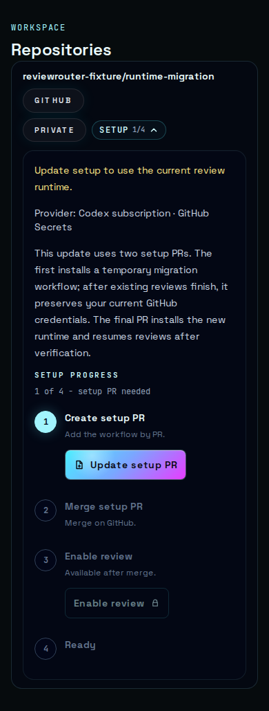
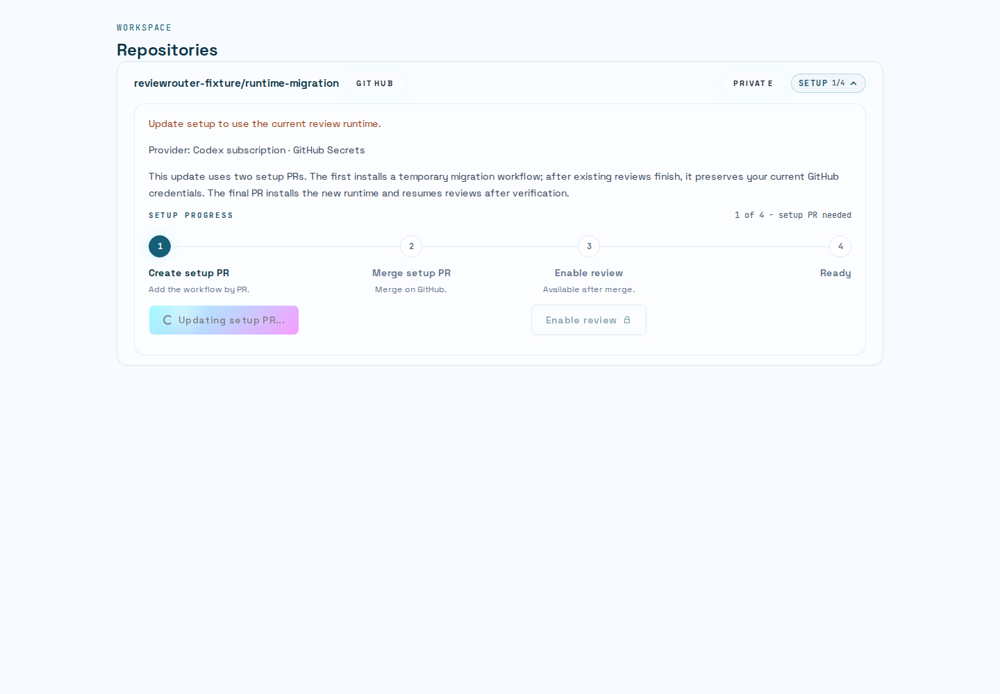

# Unified OCR review: implementation and acceptance

Status: implementation in paired draft PRs; synthetic external-boundary and real
executable checks passed as described below. Live provider/GitHub qualification,
release publication and production rollout are separate gates. The full Next
dashboard browser gate has not passed locally because compilation exhausted the
shared environment's memory. Component browser checks are recorded separately.

- Control plane: <https://github.com/777genius/review-router-ai/pull/718>
- Public Action: <https://github.com/777genius/review-router/pull/346>
- [Implementation plan](../plans/2026-10-26-unified-ocr-review.md)
- [Three rounds of plan criticism](../plans/2026-10-26-unified-ocr-review-reviews.md)
- [Installed-runtime transition](../plans/2026-10-26-installed-runtime-transition.md)

## Result and architectural boundary

The existing production T0 review runner remains the one review scenario. A
prepared connection feeds discovery and the existing lifecycle verifier, then
the existing projection/publication machinery. Credential preparation stays in
small source-specific adapters. The runner receives the selected model, route
and limits; it does not receive a raw rotating auth home or interpret GitHub
Secrets. No second review queue, publisher, connection-specific verifier or
automatic engine fallback was added.

| Connection offered today | Preparation and model route | Review behavior |
| --- | --- | --- |
| Qualified saved account through Gateway | Existing account binding and native server grant; controlled Responses relay | OCR and common verifier on the same frozen route |
| OpenRouter, MiMo Token Plan and Kimi Code API keys | Existing Secret/managed-key onboarding; controlled runner-local Responses route | OCR and common verifier; existing endpoint/model restrictions retained |
| Rotating Codex subscription Secret | Official auth-only refresh; existing sealed writeback; native Codex Responses adapter | OCR and common verifier after confirmed credential preservation |
| Hosted Codex Pool | Original opaque Hosted grant, account and request ledger; V2 native route | Same runner/verifier/App publisher without account reselection |
| Claude subscription Secret | Captured existing opaque setup token; native Anthropic Messages route | OCR and common verifier with an explicit frozen alias-to-model map |

Existing explicit supplied-diff Codex support is preserved only where its native
route is qualified. Native Claude supplied-diff is not offered by today's UI;
an old incompatible setting is rejected rather than silently changed. PR
description generation keeps its existing supported connection scope; this work
does not claim new description-generation parity on every native route.

## Run budget, uncertainty and recovery

Every new model call reserves the same durable source-run allowance before I/O.
The prepared controller binds the exact wire hash, route, work slot, ordinal and
current lease. Discovery and verification do not receive independent budgets.
Completed terminal bytes are released only after durable completion is confirmed.
An uncertain paid effect permanently fences further paid inference for that run;
restoring a reservation does not authorize another upstream call.

The server's native Gateway/Hosted ledgers remain authoritative for their native
effects. Runner-local connections use the durable V2 allowance rather than an
in-memory counter. The original deadline, request count, concurrency and byte
limits are fixed. Output usage must prove the bounded terminal receipt.

Native Codex does not support `max_output_tokens` in its actual subscription
wire. Its ceiling is explicitly **terminal acceptance**, not a hard provider
generation/spending cap. Unsupported fields are removed before hashing; excess
or absent usage makes the outcome uncertain and cannot refund the allowance.
This provider limitation remains visible in the contract and plan.

Refreshed credentials are validated and preserved by definite writeback before
checking whether their remaining lifetime covers the original review deadline
plus the safety margin. A rotation may invalidate the previous refresh token;
discarding the new token would lose a usable credential. Insufficient remaining
review lifetime blocks inference, not preservation, and never extends the run.
Claude's opaque setup token has no invented expiry or refresh operation.

Existing verifier packet/quote/ownership checks and current-head publication
fences remain in place. Missing, malformed or failed verification leaves findings
unverified and open. Unknown GitHub resolution is reconciled with observed state
before another mutation; historical receipts are never fabricated.

## Default activation and installed callers

Ordinary review admission attempts qualified history activation through the
existing drain/cut mechanism. The production writer witness binds the environment,
database identity, deployment, ingress and writer fleet. Missing or revoked
qualification fails closed for auto-resolution while permitting safe discovery.
The actual fleet observation is supplied by `rr: deploy`; synthetic witness
fixtures cannot enable a real deployment. Pre-activation comments remain manual.

Readiness compares the exact installed source against the actual configured
qualified target. Unknown source evidence offers verification; a proven stale
runtime offers the appropriate update. A compatible already-admitted immutable
caller remains valid through an explicitly trusted release overlap.

Rotating Secrets upgrades use two reviewable setup revisions: a temporary pinned
migration caller, then the final ordinary caller. Complete paginated ingress drain
and the existing provider mutation fence precede setup allocation. A signed OIDC
exchange binds the exact repository/workflow/run/namespace/generation and target.
Only the existing sealed setup PUT is used; plaintext never moves to the SaaS.
The first bootstrap PR does not falsely mark the new runtime installed. Final
enablement requires confirmed native activation and removal of the bootstrap.
No automatic PR merge or remote user migration was performed in this task.

## Observed verification

Counts below describe distinct focused runs, not a sum of unique tests. Some
regression suites overlap. Provider replies and GitHub operations are synthetic
unless explicitly stated otherwise.

| Check | Observed result | What is real and what it proves |
| --- | --- | --- |
| Paired lifecycle V1/V2 | 17/17, exit 0, no skipped/unhandled errors | Migrated PostgreSQL, signed admission, HTTPS/public transport, production relay/verifier/App worker and effect receipts; controlled discovery/provider/GitHub boundaries |
| Migration/readiness/activation regression | 58/58 across five suites | Includes all three PostgreSQL + RSA-signed OIDC migration cases with ordinary setup and all SQL guards enabled |
| Ordinary/Hosted confirmation recovery | 216/216 across two suites | Existing recovery paths, exact selected Prisma fields, native Claude source proof and legacy absence handling |
| Final public transport/runner/workflow regression | 84/84 across five suites | Gateway canonical body before claim; native Codex transport; caller schema 5 vs checkout schema 2; migration runner; T0 step selection |
| Actual OCR binary | 13 CLI + 2 MCP tests passed | Actual pinned OCR process against local synthetic protocols, not a fake OCR executable |
| Public runtime types | Full source and test typecheck passed before final artifact rebuild | Includes migration entry and latest boundary fixes |
| Changed production web types | Scoped native TypeScript exit 0, no diagnostics | Changed dashboard/actions/routes/migration modules and their dependencies |
| Production React component browser check | 148/148 assertions, 48 screenshots, zero page errors or external requests | Actual components/CSS/fonts in Chromium; Next navigation/server-action boundaries are controlled |

The paired success scenario starts with four older findings. A subsequent run
performs two discovery calls and one verifier call on the same frozen route.
Two proven fixes are closed, one still-valid and one uncertain finding remain
open, and a separate new finding is retained. The next head consumes the two
confirmed resolution receipts. Native mutation validates App installation-token
authority. Negative cases cover denied/unknown GitHub effects, missing verdict,
invalid quote, wrong packet and forged claim on both protocols; V2 additionally
covers paid disconnect/restart without new inference, discovery exhausting the
shared budget before verifier, and a changed head before App mutation.

The paired fixture intentionally omits Gateway `store`/`service_tier` defaults
and passes `reasoning: null`. The actual HTTP durable-hash gate therefore verifies
the parent normalizes the wire before claiming. This integration check found and
closed a real boundary defect that isolated transport fixtures did not expose.

The final complete paired run used a 768 MiB worker and finished in 101.43 seconds.
An earlier 512 MiB attempt stopped after 15 passing cases because of worker OOM;
its partial result is not counted. Full Next compilation attempts also remain
failed/unverified rather than being relabeled successful.

### Reproducible OCR candidate

- Version: `1.13.1-rr.5`
- Upstream commit: `8eb83340a487b1150af00701b94f01af97e4b4d6`
- Go: `1.26.10`; eleven checked-in patches; `CGO_ENABLED=0`, `-trimpath`, `-buildvcs=false`
- Binary SHA-256: `a7bed0cea8ab05503c7de53f8c3825a75c285eb8364c832accc42dbebb0d42db`
- Patch SHA-256: `83f92bae2a7f6295639813760a3aa3f7d9c66ac1fcbc0255d6f200b8754d2957`
- Public receipt: `tools/ocr/qualifications/unified-model-routes-v2.manifest`

The previous `review-skills-v1.manifest`, released immutable OCR versions and
historical callers are preserved. The separate official Codex auth-only executable
qualification is recorded in the implementation plan; it did not start a model
thread or turn.

## Visual changes verified

Desktop 1440x1000 and mobile 390x844 were exercised in both themes, including
current/update/unknown/pending/failed/migration and recovery states. The inspection
corrected discarded async action Promises that cleared pending too early,
inconsistent migration progress, an irrelevant bootstrap option and a verification
label that incorrectly implied the workflow was missing. Delayed actions remain
disabled and optimistic events cannot display false Ready.

These images are captures of the production components, not an actual full Next
page load. The full dashboard CI workflow remains the release verification gate
for Next composition; no local full-page pass is claimed.

### Integration with current onboarding and release gates

The feature branch integrates the two subsequent main changes through
`d3595c2e3e0b21ab539dea0fb7a06d35a4613faf`. Both independent UI guards remain:
confirmed credentials cannot complete an uninstalled workflow, and optimistic
events cannot claim a qualified runtime without proof. Four focused UI suites
passed 96 cases and the scoped production typecheck passed after conflict
resolution. Chromium was then rerun on the merged components: 148 assertions,
48 fresh screenshots, no page errors or external requests.

The earlier real Next CI run passed desktop and exposed a mobile navigation race
in the read-only overflow assertion. That assertion now retries its read within
five seconds when navigation destroys the execution context; it still rejects
persistent overflow. A real Chromium fault fixture confirmed both cases, and the
browser harness typecheck passed. This is not permission to retry user actions.

The new `000154_unified_model_dispatch` SQL is explicitly classified by checksum
in the existing release/rehearsal catalogue. Historical immutable manifests and
their rejection of missing, reordered, changed or future migration bytes remain
unchanged. A valid expired-authorization SQL fixture preserves the database's
lifetime guard while checking late receipt settlement. These integration checks
keep unification compatible with the separate `rr: deploy` workflow.

## Remaining final stage

With user-provided designated test credentials and a disposable repository,
qualify actual subscription access, token refresh/writeback, native headers and
selected models for each offered connection. Exercise actual GitHub OIDC,
App-authored comments, follow-up fixes, thread resolution, interruption/recovery
and the two-PR credential-preserving installed-caller migration. Confirm the
real deployment's signed writer-retirement evidence with `rr: deploy`, publish
the reproducible runtime through the existing release process and update exact
configured pins without retiring admitted overlap callers prematurely.

Draft implementation and synthetic acceptance do not imply a merge, release,
production deployment, customer workflow mutation or completed live qualification.
