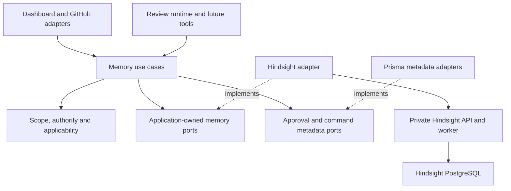

# Self-hosted Hindsight memory replacement plan

Recorded: 2026-10-23.

Status: owner-selected direction; three critique/fix rounds complete; implementation
in progress in control-plane PR #690 and paired Action PR #328.
This document is a plan, not an implementation or production-readiness receipt.
The owner selected self-hosted Hindsight and explicitly permits deleting the
unnecessary custom memory engine. The owner subsequently authorized autonomous implementation, testing, review and
merge. ADR-031 records the successor ownership and precise lease-admission semantics.
Existing ADR files remain historical evidence; production activation requires the
qualification and cutover gates below.

## 1. Decision and evidence boundary

Use a complete external memory backend, initially Hindsight on infrastructure
we operate. Hindsight owns current knowledge content, its native facts,
observations, indexes, extraction, consolidation and retrieval. ReviewRouter
owns product authorization, approval, source applicability and delivery of
authorized commands. Remove the canonical Prisma memory implementation and its
mandatory local fallback after migration; do not merely rename the search port.

This does not require a second production provider, a universal plugin framework,
or a provider-specific frontend. A future provider must implement the meaningful
application contract and pass its conformance suite. A provider that lacks a
required guarantee must fail qualification rather than return a successful no-op
or trigger a new semantic engine inside Router.

Evidence inspected:

| Source                                   | Reviewed revision / meaning                                                                                                   |
| ---------------------------------------- | ----------------------------------------------------------------------------------------------------------------------------- |
| ReviewRouter control plane               | `296ddc0327b7dfc762c31b5b1d39e5461a41c12c`                                                                                    |
| Hindsight                                | `v1.1.0`, commit `a5a619b5ca59c5c39e0f96be6f7a31fabd136bd5`, published 2026-10-21                                             |
| TypeScript client                        | `@vectorize-io/hindsight-client` 1.1.0 source and actual GitHub release artifact; npm registry installation not yet qualified |
| Organization quality standard            | `agent-teams-ai/.github` at `dcdc2838c377e90995eb6e35364a84b6684d376a`                                                        |
| Checked-in paired Action CI target       | `777genius/review-router@fca296a56637d369fc5198d4c9d8e95b9607377b`                                                            |
| Checked-in hosted/rotating Action target | `777genius/review-router@66ac53a5953c2da498f7d2c3b644dd6ef5ccf3ff`                                                            |

Action pins above are source/CI contracts, not proof of the currently deployed
configuration. The live deployment, customer records and remote deletion debt
have not been inspected. No native model benchmark, load test, restore drill or
customer-data migration has run. Prior comparison and measured source inventory
are in [the replacement study](../spikes/2026-10-23-full-memory-backend-replacement.md).

### Fit conclusion

Hindsight has the native lifecycle needed to justify implementation and
qualification. The source audit does not prove that every changing-code scenario
will work correctly. Keep the selected backend, but gate real-data release on:

1. Complete scoped reads and source attribution, including derived observations.
2. Correct ordered updates, uncertain outcomes and non-resurrection after forget.
3. A verified privacy profile, including native error/startup logging hardening.
4. Useful current knowledge in the real production review path, not only a UI.
5. A restorable self-hosted deployment and a tested core-knowledge export.

If passing these gates requires maintaining a custom semantic matching,
contradiction-resolution, vector, graph or consolidation subsystem, stop and
reassess the fit. A small transport/privacy hardening change is a different
maintenance obligation and must be explicit and bounded.

## 2. Ownership and dependency direction



Outer composition supplies the adapters. Domain/application code imports no
Hindsight SDK, native bank/document DTO, Prisma client, HTTP framework or DI
container. Browser code uses application DTOs through authenticated product
interfaces. Hindsight credentials, bank identifiers and operational endpoints
never become browser or customer Action configuration.

| Owner                   | Authoritative state / behavior                                                                                                                                                     |
| ----------------------- | ---------------------------------------------------------------------------------------------------------------------------------------------------------------------------------- |
| Hindsight               | Current approved knowledge document bodies; native facts, observations, entities, embeddings, graph, ranking, consolidation and native lifecycle                                   |
| Router product          | Workspace/repository/user identity; membership and permission; approval and revocation; source revision/applicability; explicit rule exceptions; review admission and presentation |
| Router integration      | Opaque scope/provider bindings; command identity, expected application revision, ordering, progress, deletion intent and audit metadata                                            |
| Existing app PostgreSQL | The above product/integration records, plus bounded immutable approved command input while delivery is unresolved                                                                  |
| Hindsight PostgreSQL    | Provider-owned content, native operations and provider schema; never accessed through Router Prisma                                                                                |

The command input is a temporary delivery envelope, not an editable knowledge
record. It cannot serve list, recall, export or current-body edit requests. No
current knowledge is reconstructed from it. It is write-once for its command
digest and removed after verified publication or explicit terminal resolution,
under a bounded retention policy. This closes the crash-before-provider-accept
gap without recreating `MemoryItem` as a second writable content store.

Use the existing `@reviewrouter/features-memory` boundary. Integration follows
Get Modular 0.7.0, already adopted by current main, and retains Engineering
Foundation 2.1.0 scoped adoption.
Only composition imports Get Modular; only `memory.hindsight` imports the SDK.
Extend the existing Foundation policy and rejecting fixtures for new sources.
Do not silently adopt a newer FMS, another database library, Temporal, NATS,
Dapr or a new organization-wide stack as part of this feature.

Library-first does not require publishing an extra Hindsight wrapper: the
upstream SDK already supplies the reusable protocol client. A Router-specific
policy adapter has one real consumer and stays with its owning feature.

## 3. Small application contracts

Separate roles according to actual consumers. The adapter may implement all of
them, but a bundle builder cannot obtain mutation capabilities accidentally.

| Role               | Required operations                                                                            |
| ------------------ | ---------------------------------------------------------------------------------------------- |
| Knowledge reader   | Scoped recall; source-entry listing; read current entry and evidence                           |
| Candidate preview  | Extract bounded candidates from permitted input without publishing memory                      |
| Knowledge writer   | Save approved entry; replace; retire; delete; change topics                                    |
| Operation observer | Observe native submission/progress; reconcile uncertain outcomes; qualified cancellation/drain |
| Portable export    | Export approved core entries, scope, identity, provenance and declared history fidelity        |

Every write, including topic change, invalidation and deletion, has a command ID,
an expected application revision, a target scope and an honest operation result.
Deletion is not typed as `Promise<void>` when native cleanup can still be pending.

```ts
type MemoryScope =
  | { kind: "workspace"; workspaceId: string }
  | { kind: "repository"; workspaceId: string; repositoryId: string }
  | { kind: "user_preference"; workspaceId: string; userId: string };

type MutationContext = {
  scope: MemoryScope;
  entryId: string;
  commandId: string;
  expectedRevision: string | null;
};

type MemoryOperation = {
  id: string;
  state:
    | "queued"
    | "submitted"
    | "processing"
    | "published"
    | "failed"
    | "unknown"
    | "cleanup_pending"
    | "completed";
  safeReason?: string;
};

interface KnowledgeWriter {
  saveApproved(
    input: MutationContext & ApprovedKnowledge,
    controls: RequestControls,
  ): Promise<MemoryOperation>;
  retire(
    input: MutationContext,
    controls: RequestControls,
  ): Promise<MemoryOperation>;
  remove(
    input: MutationContext,
    controls: RequestControls,
  ): Promise<MemoryOperation>;
  setTopics(
    input: MutationContext & { topicIds: readonly string[] },
    controls: RequestControls,
  ): Promise<MemoryOperation>;
}
```

These are design shapes, not final public wire DTOs. `expectedRevision` is an
application precondition, not a claim that Hindsight exposes CAS/ETag. Requests
use a null expected revision only for create-if-absent; every existing-entry
mutation supplies a revision. Keep the full-command digest separate from the
approved text's body digest and distinguish UI/entry revision from content
approval revision, so a topic change cannot fabricate a new text approval.
Requests carry deadlines/cancellation, and errors normalize to application-owned codes
such as unavailable, conflict, unsupported, incomplete evidence and unknown
write. Provider error text cannot enter product responses or logs.

Distinguish stable writable `EntryRef` from read-only `ObservationRef` in result
types. Native derived IDs can change after consolidation/import and cannot be
passed to a source-entry mutation accidentally. Both references remain scoped.
Protect reserved kind/publication tags from user edits. The generated SDK can
return an error object without throwing by default; the adapter must validate
HTTP status and response shape before normalizing any successful result.

Required capabilities are startup/deployment qualifications, not silent fallbacks.
Validate local configuration and composition without remote I/O. Qualify native
capabilities at deployment/canary admission and report feature-local health.
A Hindsight version/health/bank outage must not fail shared API/web/worker startup
or global readiness. Enabled but unusable memory is unavailable/degraded; release
checks block enabling memory, while ordinary review remains available.
Extra capabilities such as generated knowledge pages or advanced reflection get
their own role only when a real feature uses them. No generic graph query DSL,
abstract base repository or runtime plugin loader is needed.

## 4. Scope, identity and groups

Resolve one native bank per actual authorization boundary: workspace-shared,
repository-local, and user-private preferences if existing data requires that
scope. Personal and organization workspaces share the same application model.
A user's personal workspace is not automatically included in organization reviews.

Use stable internal IDs rather than repository slugs. Keep bank mapping and
backend generation server-side. All object access remains scoped; a valid object
ID alone never grants access. A service key authenticates Router to Hindsight;
it does not replace user/workspace/repository authorization.

Review context uses independently bounded workspace and repository queries with
labeled sections. Preserve native ranking within each section. Do not compare
native scores across banks or add a custom reranker. This topology provides no
single graph or transactional snapshot across banks; that is an explicit limit.

Groups are organizational topics, initially one primary group plus optional
tags. They do not change readership. If a group needs different access, model a
real scope boundary rather than trusting tags as ACLs. Keep native consolidation
scope stable by knowledge kind, independent of cosmetic topic moves; qualify
the actual native `observation_scopes` configuration. Group names can change
without changing entry or source identity.
Router owns scoped group IDs/names; membership lives in the provider document's
topic tags. Pending command input records desired changes only until settlement;
there is no second independently writable current membership list in Prisma.
The adapter preserves reserved tags when changing user topics.

Promotion from repository to workspace is an explicit authorized copy/publication
with a preview of its broader audience. Never silently promote private knowledge.
Recheck source-link visibility too: private repository names, URLs and provenance
must not become public to new readers merely because the statement is shareable.
Repository rename preserves identity; transfer/disconnect requires rechecking
scope ownership and access. Workspace deletion revokes runtime access first and
then executes the tracked provider cleanup. Historical references cannot keep a
revoked source accessible through another lookup path.

## 5. Product knowledge model

One approved, bounded knowledge entry maps to one stable Hindsight document.
The document contains the approved distilled statement, not the original thread.
Edits replace that same document; revision is metadata, not part of document ID.
This gives the product a real native delete operation even though the pinned
public API has no single-fact hard-delete route.

Distinguish two meanings:

- **Approved rule:** intended convention, decision or exception. It remains
  authoritative until an authorized edit/retirement or an explicit scoped
  exception. A code change does not silently repeal it.
- **Approved observation:** a statement about implementation/experience at a
  source revision. Hindsight can consolidate it with other approved evidence;
  derived conclusions do not gain authority to change a project rule.

For approved source text, qualify a named native `chunks` strategy first. It
avoids a second extraction rewriting what the user approved. It does not perform
LLM entity extraction. Native preview entities, when still valid after editing,
or native `verbatim` metadata extraction can be qualified when graph quality
needs them. Router does not build an entity extractor.

Exactness is a tested normalized-text contract, not an assumption that every
Unicode sequence is byte-preserved: the native ingress normalizes some content.
Reject unsupported input and verify provider readback against the approved
normalized digest. An unknown strategy silently falling back is a failed
provisioning check, not acceptable success.

History in the first release means actor/time, source, scope, approval, revision,
hash and outcome plus current provider-owned text. Native document history is
metadata/counts, not a durable old-text diff log. Full historical body diffs need
a separately specified immutable audit/export policy and are not promised here.

Mental models, generated knowledge pages and direct provider UI mutation are
outside the first review-context path. Native retraction refresh exists, but
when all sources disappear some native paths preserve prose/history. Deferring
these optional outputs avoids claiming erasure/readiness that is not qualified.
It does not remove native facts, observations, consolidation or hybrid retrieval.

## 6. Actual Hindsight integration

Use the public root of `@vectorize-io/hindsight-client` 1.1.0. It exports the
generated `sdk`, `createClient` and `createConfig` as well as the convenience
client. The generated public SDK covers the initial surface; a second client
library or private subpath imports are unnecessary.

Prefix below: `/v1/default/banks/{bank_id}`.

| Product operation           | Native operation / important qualification                                                        |
| --------------------------- | ------------------------------------------------------------------------------------------------- |
| Preview                     | `POST /memories/dry-run-extract`; transient result, no native approval queue                      |
| Save/replace approved entry | `POST /memories`, stable document ID, replace mode, async caller UUID, verified strategy          |
| Review recall               | `POST /memories/recall`, explicit kinds/types/budgets and source evidence                         |
| Read/list entries           | Document API plus scoped memory listing/read; distinguish source entries and derived observations |
| Exact-source retirement     | `PATCH /memories/{id}` invalidation for its source facts; product admission revoked first         |
| Delete entry                | `DELETE /documents/{id}` plus operation-payload cleanup and verification                          |
| Change groups               | Native document tag update, with stable qualified observation scope                               |
| Progress/recovery           | Native operation status/children/cancel and terminal operation deletion                           |
| Portability                 | Application export built from provider current text and Router authority/source metadata          |

Do not invent `/memories/retain`, external expected-version CAS, a public
single-memory hard-delete route, a native approval queue, or lossless graph
migration. Public `PATCH` curation is useful for extracted-fact repair, but it
does not update the original document and can be lost on reprocessing. The
product's durable edit path replaces the approved source document.

## 7. GitHub learning and correction

The current implementation is not already a complete conversational-learning
pipeline. The Action's existing `memory-interaction.ts` mainly recognizes and
cleans explicit/natural remember commands. Its discussion path does not currently
emit model-selected durable knowledge. Treat conversational selection as new
integration work, not a free consequence of changing the database adapter.

### First useful admission path

1. Accept an authorized manual statement or the bounded distilled candidate
   envelope permitted by ADR-018. Validate every field; renaming a raw thread to
   `candidateBody` does not make it distilled.
2. Resolve the actual source and trusted repository/PR identity. Bind source
   IDs, content hash/revision, head/base context and authority to the proposal.
   Source freshness must not rely only on client-supplied hashes.
3. Use native preview/related recall where it adds value. The first live path
   does not send raw discussion/code into the control plane or native engine.
4. Show the statement, kind, scope/group, source and related target. A permitted
   manual Save is itself approval; do not add a redundant confirmation screen.
5. For a suggestion, require the authorized user to choose Create, Update the
   selected entry, Record an explicit exception, or Reject. Bind that decision
   to the exact approved text and revision.
6. Submit approved content through the durable command path. Hindsight then owns
   native memory processing and retrieval.

For unknown correction targets, native related recall can propose candidates;
the user selects the target before destructive replacement. Do not append a
sentence saying an old rule is false and assume retrieval will enforce it.
New observation evidence may use native consolidation; an authored rule needs
an explicitly authorized change.

Later raw-discussion extraction may use native dry-run behind the same preview
port, but requires an explicit source-ingress/privacy successor and qualification
of every persistence/log path. Keep this separate from first-backend cutover.
No new Router semantic classifier/reconciler is proposed. Existing runtime
candidate envelopes or allowed explicit text are the conservative first input;
the current parser is not described as an implemented model distiller.

In the strict first profile, trusted GitHub metadata can verify object/repository
association, actor, updated time and head/base without fetching the raw body.
A client-supplied body hash remains a claimed digest, not a verified source
preimage. Approval binds the human-reviewed statement to the checked metadata
revision; it does not certify that the raw source entails that statement.
Stronger body verification/extraction belongs to the explicitly permitted
transient source-processing profile, not a hidden raw-ingress expansion.

### Source changes

Store stable source identity separately from its revision and from approval
revision. Late webhooks do not become newer truth by arriving later. Manual
edits produce a maintained revision; a later source edit creates a proposal,
not an automatic overwrite. A missing source means unavailable provenance, not
proof a rule is false. Implementation observations record the observed commit;
commit ancestry/applicability must be checked when the feature relies on it.
Pass trusted statement time explicitly into native retain `timestamp`; omitted
timestamps default to ingestion time. For newly authored or changed normalized text, use the checked source revision's
statement/update time; for a new manual statement use its authorized decision
time. Keep observed-code time, approval time and ingestion time distinct.

In the first profile, unchanged normalized text plus a newer source revision or
reapproval updates provenance and last-verified metadata but deliberately keeps
the original statement event time. Native delta retain can update document
parameters without updating fact temporal columns. Read back actual fact times;
new document `retain_params` alone is not temporal proof. A request to represent
the same text as a new temporal observation is unsupported until a bounded
native update/reprocess sequence is qualified; reject that variant before
delivery. Do not create a Router temporal reconciliation algorithm. Include the
same-body/new-source-time case in qualification. Validate the authoritative
source cursor atomically even when proposals target different entry IDs.

Declared source/path changes may flag observations for revalidation. Arbitrary
code changes cannot be interpreted as semantic invalidation without evidence.
Native temporal ranking is not a hard applicability filter. This plan promises
explicit provenance and correction workflows, not automatic understanding of
every future code change.

## 8. Authority and the real review runtime

Keep `MemoryPermissionPort` as the product authority boundary, and fix its
implementation: ADR-021 promises repository maintainer authority, but the current
Prisma adapter principally allows workspace owner/admin and local admin. The
new path must qualify authoritative repository-role resolution; ordinary GitHub
write permission, a PR author and a bot are not sufficient approval authority.
Resolve approval actors to stable trusted identities before repository-role
checks. Do not copy the login-only local-admin bypass into the production memory
authority path. Any required development override belongs to an explicit local
profile, separate from customer authority, with a rejecting production fixture.

The current Action memory GET does not itself establish fork confidentiality.
Bind memory reads to a trusted review request, repository, PR and head revision,
then apply fork/external-contributor policy before selecting scopes. Clients
cannot turn a query parameter into authority for private workspace memory.

The checked-in paired/hosted T0 runtime targets do not currently inject a memory
bundle and emit `memoryBundleHash: null`. Legacy orchestration has a memory path,
so changing only its API would not establish production T0 integration.

Plan a paired change in `777genius/review-router`:

- Establish a versioned memory request/result contract and trusted review binding.
  Existing manifest `memoryBundleHash` is already nullable; check its owning
  contract before proposing any unrelated whole-review protocol version change.
- Add bounded/cancellable memory retrieval in the actual T0 review path.
- Preserve ordinary review on disabled/unavailable memory.
- Include the used bundle identity/hash and policy/provider generation in the
  correct prompt/cache/replay/attestation inputs; do not emit an unobserved hash.
- Separate intended rules, explicit exceptions and at-commit observations in
  prompts. The existing blanket "current code overrides memory" instruction
  cannot decide whether an intended rule has been violated.
- Update command parsing and async result UX if IDs/statuses change; do not leave
  incompatible legacy writers enabled during cutover.
  Preserve stable Router handles where useful. The old client recognizes only
  created/updated/noop/rejected and must not translate queued work into "Saved".
- Qualify the real caller/runtime artifacts under existing App-first/OIDC and
  release contracts. Inspect deployed refs; source main is not production proof.

Authorize and freeze one exact rendered memory snapshot before assembling an
invocation manifest. Providers within the same admitted ensemble use that
snapshot. Retries never refetch changed text under an old hash. Fresh or cached
invocation admission rechecks current revocation/binding eligibility; if it
changed, prepare a new manifest with new eligible context or no memory. The
snapshot is not a new persistent raw-prompt archive. Decide explicitly whether
PR-description tasks use memory; review authority does not automatically extend
to every model task.

## 9. Ordered writes and crash recovery

Use the existing app database/outbox for command coordination, not a new queue.
Reserve command identity, exact approved payload digest, expected revision,
approval, backend generation and audit in one app transaction. Outbox carries
only IDs and safe metadata; a bounded write-once delivery record holds the
already approved envelope until native publication/terminal resolution.
The digest covers the entire normalized semantic command, including scope,
target, source revision, kind, topics, applicability and provider profile version;
hashing only the text does not bind the actual approved effect.

The Router worker dispatches all product mutations through one application path.
Across API/web/worker processes, atomically permit only one unresolved mutation
for a `(backend generation, scope, logical entry)` at a time. Use database claims
and revision preconditions, not in-memory locks. A lease expiring cannot authorize
a newer mutation while an older native call may still execute.
This limits external mutation dispatch, not urgent revocation intent. Retire,
expire or forget may atomically record an immediate eligibility fence while an
older write is unknown. Its provider cleanup waits for that write's drain or
resolution; a late acknowledgement cannot clear the newer fence. New writes
remain blocked until the intent is satisfied.

Native async UUID dedupe checks bank/type/identity, not payload equality. Router
must reject reuse with a changed digest. Native per-document serialization helps
internal consistency but is not external CAS. Keep the UUID through retries;
never issue a new one merely because an HTTP response timed out.

| Failure point                            | Required behavior                                                                         |
| ---------------------------------------- | ----------------------------------------------------------------------------------------- |
| Crash before native submission           | Reconcile same persisted approved envelope and UUID under the bounded retry profile below |
| Native accepted, response lost           | Observe same UUID/children; preserve unknown state until resolved                         |
| Changed body with reused UUID            | Reject before native I/O                                                                  |
| Old native operation has been pruned     | Consult terminal app state; absence is not proof of non-execution                         |
| Older source/approval arrives later      | Reject stale revision or create a new reviewed proposal                                   |
| Worker lease expires during request      | Do not advance a newer mutation until old outcome is resolved                             |
| Partial extraction/consolidation failure | Do not mark every capability ready from parent completed status                           |
| Backend unavailable                      | Preserve pending work; reviews use no memory; no hidden Prisma content fallback           |

Reclaiming an expired dispatch claim starts observation of the same command.
The persisted pre-I/O marker cannot distinguish a crash before sending from an
accepted request whose acknowledgement was lost. Resubmission requires the exact
approved envelope and UUID, an explicit persisted retry deadline, current
delivery permission, and a qualified native retention profile that prevents
operation pruning during that window. The initial unqualified profile sets the
retry window to zero. Without that authority, absence remains visible `unknown`
or, after bounded envelope retention, `input_required`; lease expiry alone never
authorizes another native submission.

Use supported native readback/status, not internal `result_metadata`, as the
product proof of publication. Bound payload retention and unresolved operations;
expiry becomes visible operator debt/input-required resolution, not silent loss.
The exact window must be chosen with native operation retention and backup policy.
The guarantee is one logical application publication for a command, not exactly
one LLM call, embedding computation or billed request under native retry.

## 10. Retrieval and publication readiness

Current approved source entries come from Hindsight, joined with product
approval/revocation/applicability metadata. This is not canonical Prisma body
rehydration. Pending replacement/retirement/deletion excludes the affected source
from review admission immediately; missing required provenance excludes the result.
Capture the relevant eligibility epoch before retrieval and recheck it before
returning the bundle. Discard/retry within budget if authority/fence state changed.
This is not cross-database snapshot isolation and cannot retract text already
sent to an executing external model request.
Apply the same current body-digest/content-revision/approval/lifecycle validation
and final epoch/expiry check to detail, list, evidence and export, not just review
bundles. Never pair an old native body with a newer approval record. Eligibility
is specific to the consumer: runtime admission excludes retired/expired entries,
while an authorized manager/exporter may inspect their settled retained provider
body under the declared retention profile, labeled ineligible. Current scope,
body digest, approved revision and deletion fences still apply. Forget removes
body visibility on every product read immediately, even during pending cleanup.
Report unsettled/omitted export entries explicitly; disabled memory does not
remove authorized cleanup/export access.

For derived observations, validate every returned supporting source identity,
not only the first citation. `include.source_facts` can be truncated; inspect the
native truncation flag and hydrate bounded missing evidence or omit the result.
An observation supported by both an active and a fenced source is not fully
eligible. Do not cache privileged results across scopes or membership changes.
Do not expose the whole native response: disable unused top-level entity/chunk
inclusions and return only mapped results with qualified supporting evidence.
Preserve one total default 2,000 ms memory-retrieval budget, including both scope
queries, native/SDK retries, evidence hydration and final metadata recheck. Do not
multiply it per call. Bounded timeout/cancellation yields a memory-free review;
background operations keep their separate deadlines and progress semantics.

Consolidation readiness and semantic correctness are distinct. Example: source
E1 says timeout=30, E2 says timeout=60. Retain(E2) may complete while consolidation
is pending, leaving an observation supported only by E1. Complete provenance of
that old observation alone does not establish current truth.

For the initial release, derived observations are explicitly at-commit/historical
context unless the following scoped readiness protocol passes qualification:

1. Fence the observation section for the scope/kind while admitted observation
   changes are unsettled; exact approved rules remain separately available.
2. Read back the complete expected current source-fact ID set using supported
   memory-list APIs. `consolidation_state=done|pending|failed` is a list filter;
   returned rows expose `consolidated_at` / `consolidation_failed_at`. Require
   all expected IDs done/nonfailed, not an empty filtered page or merely a
   completed retain/consolidation parent operation.
3. Resolve all relevant commands for the same app scope epoch; check that epoch
   has not changed while assembling recall.
4. Pass the real-model stale-state corpus, including later evidence and delayed
   old evidence. Native processing completion is not proof of good reconciliation.

This is publication coordination, not a Router semantic affected-fact graph.
If a sound bounded readiness profile cannot be qualified, keep observations
non-normative and do not market them as automatically current. The selected
native backend still supplies storage, recall, source updates and consolidation.

Explicit repository exceptions reference exact shared rule IDs. Apply that
deterministic relation; do not infer an override from semantic similarity. An
unresolved conflict should be visible and must not generate a confident finding
that arbitrarily chooses one rule.

## 11. Retirement, forget and cleanup

Retire means stop using knowledge while retaining allowed history. Forget means
remove the product entry and tracked body copies from live provider storage.
Expose these as different user actions with honest progress.

| Lifecycle action    | Application postcondition                                                                                                                 |
| ------------------- | ----------------------------------------------------------------------------------------------------------------------------------------- |
| Retire              | Immediately excluded from new review context; native source facts invalidated; permitted audit/source history retained                    |
| Restore             | Fresh authorized ordered command on the exact retained revision; no automatic replay of a pre-retirement job                              |
| Expire              | Same runtime exclusion as retire when a declared validity bound ends; no semantic aging algorithm                                         |
| Forget              | Immediate admission revocation, then tracked deletion of native entry and associated live body copies; incomplete cleanup remains visible |
| Restore from backup | Memory stays disabled until current revocation/deletion/generation metadata is reconciled                                                 |

Retire/restore/expiry are not implemented by overloading hard delete. Optional
restore is exposed only if the provider's qualified profile supports it. Native
invalidation must cover all facts of the logical entry, not a guessed single ID.
The first profile uses these lifecycle preconditions:

| State                    | Review use                                                | Authorized management/export                       | Content/topic mutation                                             |
| ------------------------ | --------------------------------------------------------- | -------------------------------------------------- | ------------------------------------------------------------------ |
| Settled active           | Allowed only after current authority/applicability checks | Current provider body                              | Ordered command with expected revision                             |
| Settled retired/expired  | Excluded                                                  | Permitted retained body, labeled inactive          | Reject until a qualified restore; forget remains available         |
| Unsettled create/replace | Excluded                                                  | Safe progress metadata; no mismatched current body | Block another external mutation; allow immediate revocation intent |
| Forget pending/completed | Excluded                                                  | Safe cleanup status only; no body                  | No restore or old-command replay                                   |

Native retagging updates live facts, not necessarily archived ones. Rejecting
content/topic edits while retired avoids promising archive synchronization.
If restore is enabled, qualify exact retained text, topics and source identity
before publishing the restored revision.

On forget, revoke runtime admission and persist a deletion intent first. Fence
all new source submissions/retries. Native retain caller UUID can be a parent
with executing children: cancelling only the parent does not stop its leaves.
Enumerate relevant children, cancel them and establish execution quiescence;
cancelled status alone is not drain proof. Then delete the native document,
remove associated terminal operation payload rows, and verify absence through
the actual read paths. Do not delete children while their batch parent is active.

**Initial physical-forget profile: an operator memory pause.** Public native
cancellation has no per-entry execution-drained receipt. Persist the entry fence,
pause all Router memory submissions/retries, and stop every native executor,
including API internal workers and old/rolling worker replicas. Require confirmed
process exit and closure/rollback of their database sessions. A rolling redeploy,
a sent signal, a failed health probe or `cancelled` status is not that receipt.
Normal reviews continue without memory during this interval.

Run a private cleanup API from the same qualified image with these supported
settings; keep ordinary product mutation ingress fenced:

```dotenv
HINDSIGHT_API_WORKER_ENABLED=false
HINDSIGHT_API_RUN_MIGRATIONS_ON_STARTUP=false
HINDSIGHT_API_CONSOLIDATION_RECONCILE_INTERVAL_SECONDS=0
HINDSIGHT_API_MENTAL_MODEL_REFRESH_TICK_SECONDS=0
HINDSIGHT_API_RETENTION_SWEEP_INTERVAL_SECONDS=0
HINDSIGHT_API_OPERATION_CLEANUP_INTERVAL_SECONDS=0
```

The zero cadence settings disable the native maintenance loop in this profile.
Enumerate tracked and historical relevant retain parents/children, including
queued work released by shutdown. Use public operation list/status/cancel/delete
and document-delete calls: cancel stable queued/requeued leaves, terminalize
parents, then remove the source document and associated terminal payload rows.
Record child identities before deleting parents; an absent parent is not proof
its children are absent. Keep one logical source per retain submission in the
first profile and qualify paginated bank-operation discovery for older payloads.
Verify native read/evidence/payload absence, clear the Router delivery envelope,
then restart processing with fences retained. Verify absence again after restart
and settlement of remaining native work. Missing evidence remains cleanup_pending.

Slice 0 must prove the exact host stop/exit receipt, including overlapping old
instances; a managed-service suspend acknowledgment alone is insufficient. The
same-image fixture must show resolved cleanup configuration, no maintenance loop,
and a queued sentinel that does not execute. Batch pending physical forget into
an operator maintenance window initially; unrelated memory writes can wait.
The UI reports immediate removal from use and pending cleanup until closure.
Ordinary successful replace/retire stay online: ordered dispatch waits for actual
successful child completion/readback, and retirement invalidates all source
facts after any unresolved retain settles. A future online per-entry drain may
replace this operational limitation only after its mechanism and races pass.

Keep cleanup_pending state and retry evidence through partial failure. A known
deleted source must never be re-submitted by an old queued command or restored
worker generation. Clear the temporary Router envelope as part of forget. Native
observation cleanup is provider work; qualify it rather than building a graph
retraction service in Router.

Mental models/pages are not created in the initial profile. If enabled later,
the forget contract must cover their content, reflect response and history:
native refresh/clear does not universally erase old prose. Similarly, exports,
backups and logs need declared retention/restoration controls. Do not claim
instant physical erasure from backups; restore must replay current deletion
fences before memory is served again.

## 12. Self-hosted operational profile

Use a separate private Hindsight API, native worker and Hindsight PostgreSQL 17
database, in the existing Router region/environment. The checked-in deployment
is Render Frankfurt; self-host here means our operated Hindsight service, not
Hindsight Cloud. Native OCI/Compose setup remains usable on a dedicated server;
this plan does not authorize purchasing or deploying new infrastructure.

Use API-only image `ghcr.io/vectorize-io/hindsight-api:1.1.0`, resolve and verify
its immutable digest/provenance, and run API and worker from the same reviewed
image. Set `HINDSIGHT_API_WORKER_ENABLED=false` on the normal API and
`HINDSIGHT_API_RUN_MIGRATIONS_ON_STARTUP=false` on long-running services; migrations
belong to the release job. Use a stable, unique `HINDSIGHT_API_WORKER_ID` per
standalone executor and a traceable process/generation identity for stop evidence.
Do not use floating latest or an embedded development database. Use
native PostgreSQL task processing, pgvector and supported native text search.
Do not add Redis, Kafka, Kubernetes or another orchestration platform for this slice.

On Render, both API and worker can be private services so internal monitoring
can reach worker health/metrics. Private service provider checks are TCP-only;
add native HTTP readiness/liveness and queue/poll-age monitoring internally.
A Render background worker cannot receive those private incoming probes.

Keep Hindsight schema/migrations/credentials separate from Router Prisma and
Router release authority. Bootstrap extensions and run Alembic from a bounded
release/admin job. Native bank/index maintenance performs runtime index DDL;
do not falsely claim DML-only grants suffice. Qualify bounded object ownership
inside the isolated database, without superuser or access to Router's database.

Configure service authentication and private ingress. Disable unused MCP,
uploads and direct user access. The native service key can address multiple
banks; Router's scoped authorization remains mandatory. A native admin UI, if
later enabled for operators, must not bypass product mutation ordering.

### Privacy and logging release gates

Durable input contains confirmed distilled statements only. Keeping native
document text enabled is deliberate: it stores that approved statement and
allows provider-owned editing/reprocessing. Turning it off does not remove
async payloads, metadata, logs or traces and does not make raw retention safe.

Explicitly disable native LLM traces, OpenTelemetry prompt/content tracing and
bodyful native audit. Validate safe metadata/context fields as well as content.
Use Router's metadata-only audit. Set extraction errors to fail visibly and
verify actual resulting source facts instead of trusting a generic completed bit.

Pinned source contains concrete logging defects relative to our requirements:

- unexpected retain failure logs content excerpts, context and traceback;
- Recall/Reflect log query prefixes at INFO;
- malformed consolidation output can log full model text at WARNING;
- mission merge can log model response prefixes;
- standalone worker startup prints the full configured database URL;
- provider failure logs may include response-body excerpts; native task errors
  persist raw exception/traceback text in async operation errors and parent copies;
- the shared HTTP exception handler can log raw exceptions and return their text.

Before real credentials or data, use an upstream fixed release or a minimal
reviewed/pinned hardening patch that removes these payload/credential outputs. Log-level changes
alone do not cover all paths. Verify startup, normal reads and injected failures
with synthetic sentinel credentials/text through stdout/stderr, collectors,
database trace/audit tables, native operation error/parent copies and HTTP errors.
Pin request/error-body debug dump options off and test provider 4xx/5xx echo
responses. Sanitize diagnostic sinks without changing internal provider-error
classification/retry behavior, which can inspect those original responses.
Do not silently maintain a semantic engine fork; track the small patch and its upstream-removal condition explicitly.

Slice 0 produces the exact hardening diff, source/lock/base-image identity,
reproducible build recipe, final derivative-image digest, named maintainer and
upstream-removal condition. Smoke API and separate worker from those final bytes;
tests of an unpatched checkout do not qualify the deployed image. If an upstream
release resolves the issues, qualify that successor instead of keeping a fork.

Self-hosted memory does not imply self-hosted inference. An external LLM,
embedder or reranker receives the respective input. Choose and record that data
egress separately; never reuse customer review credentials. Native local
embedding/reranking options reduce egress, but their English-default models are
not evidence of quality for Russian/multilingual code-review knowledge. Qualify
model quality, dimensions, footprint and budgets; no RAM/latency/cost promise is
made from source inspection.

Back up the native database and app metadata with a compatible recovery point
and generation manifest. Restore privately, reconcile commands/deletions and
verify source identity before serving. Upgrades rehearse native migrations on a
restored disposable database and pin image/model/config identity. Native schema
rollback is not assumed. Memory can be disabled while normal reviews continue.

Provider-only restore can use intact current Router deletion/revision metadata.
If both databases roll back before a completed deletion, neither old snapshot
contains that deletion fence. Do not reopen restored memory automatically. Recover
post-backup metadata from an independently retained WAL/journal recovery point,
or keep the affected memory fenced until its complete disposition is re-established.
Reapproval alone is not proof that previously forgotten content may be restored.
The first supported restore runbook must state its RPO, retained metadata
evidence and this failure condition; a backup file alone is insufficient.

## 13. Integration and deletion inventory

| Surface                                         | Planned treatment                                                                                                                                                 |
| ----------------------------------------------- | ----------------------------------------------------------------------------------------------------------------------------------------------------------------- |
| `features/memory` domain/application            | Keep scope, authority, privacy and bundle policy where valid; replace canonical item/search/transaction assumptions with the small ports and publication workflow |
| Prisma item/suggestion/search repositories      | Remove canonical content/search implementation after data disposition; retain/adapt only actual approval/source/command metadata responsibilities                 |
| Infinity search adapter and SDK                 | Drain known/unknown external obligations, then delete unused projection adapter/config/dependency; no re-inspection of Infinity internals                         |
| Projection receipts/backfill/reconcile/operator | Remove only after deletion debt is resolved; receipts deliberately survive canonical deletion                                                                     |
| Old memory expiry/prune                         | Replace source-entry lifecycle with native operations and bounded product policy; do not copy a second engine scheduler                                           |
| Action API routes                               | Replace dependencies, authority/review binding, operation responses and versioned contract; reject stale legacy writers                                           |
| API/web/worker composition                      | One feature-owned composition contract, adapted for each process; borrowed resources retain host ownership                                                        |
| Dashboard dependencies/export                   | Remove direct Prisma body reads, use backend reader/export and scoped metadata                                                                                    |
| Dashboard page                                  | Keep development notice until the new vertical slice and visual checks pass                                                                                       |
| Old management panel/fixtures                   | Remove unreachable engine-coupled implementation when the replacement UI lands; retain useful shared UI primitives                                                |
| Support diagnostics/quotas/usage                | Replace canonical row/index counts and item FKs with scoped provider/operation metadata; no bodies in support output                                              |
| Prisma schema                                   | Add narrow metadata/delivery records, migrate dependent FKs, drop obsolete tables only in forward migrations                                                      |
| SQL migration history                           | Preserve; never rewrite deployed migration files                                                                                                                  |
| Foundation/build/dependency tests               | Update explicit owned sources and negative fixtures; remove obsolete SDK permissions without weakening other boundaries                                           |
| Separate Action repository                      | T0 memory consumption, candidate/source contract, prompts, operation UX, bundle/cache/attestation identity and paired E2E                                         |

Current outbox reloads the body from `MemoryItem`; it cannot survive deletion of
that table unchanged. `MemoryUsageEvent` has an item FK/cascade; adapt it before
dropping canonical rows. Support diagnostics and the still-live export route
also read old tables. A paused UI is not a backend write fence.
Inventory queued, claimed, unknown and dead-letter legacy `memory.*` event
type/version pairs. Assign each a settled, fenced or explicitly owned cleanup
disposition before its handler/schema is removed. The current worker registers
ten version-1 memory event types; do not silently drop delayed old events.

Preserve the existing service/workspace kill switch and logical-entry quota
meaning. Native fact/observation fan-out is not the number of user knowledge
entries. Reserve quota during command admission; limit pending commands and
inference spend separately. Support diagnostics report logical states, unknown
operations and cleanup debt without reading bodies. Existing user preferences
need an explicit migration/disposition; production Action still receives no
arbitrary user's private preferences. Future authenticated tools use their own
user-scoped authorization.

### Verified file owners for implementation

All control-plane paths below are relative to `777genius/review-router-ai`.
`M` means `packages/features/memory/src`. These are change owners, not whole-file
deletion instructions.

| Owner              | Existing paths                                                                                                                                                                                                                                                   |
| ------------------ | ---------------------------------------------------------------------------------------------------------------------------------------------------------------------------------------------------------------------------------------------------------------- |
| Canonical content  | `M/domain/memory-item.ts`, `memory-suggestion.ts`; item/suggestion repository ports and Prisma repositories/mappers                                                                                                                                              |
| Projections        | `M/application/ports/memory-search-index-port.ts`; `M/infrastructure/infinity/`, `projection/`, `outbox/memory-index-outbox-handlers.ts`; Prisma search/receipt/backfill adapters                                                                                |
| Host consumers     | `M/composition/index.ts`; `apps/api/src/app.ts`, `action-memory-routes.ts`; `apps/worker/src/worker.ts`, `memory-maintenance.ts`, `memory-projection-maintenance.ts`, `memory-projection-operator.ts`; `apps/web/src/server/dashboard-memory.ts`                 |
| UI and export      | `apps/web/app/dashboard/dashboard-workspace-page.tsx`, `actions.ts`, `memory-management-panel.tsx`, `memory-development-notice.tsx`, `memory-preview/page.tsx`; `apps/web/src/features/memory/application/`; `apps/web/app/api/dashboard/memory/export/route.ts` |
| Metadata consumers | `packages/platform/db/prisma/schema.prisma`; `packages/features/support-diagnostics/src/`; memory entitlement adapters; `apps/web/app/fair-use/page.tsx`                                                                                                         |
| Gates              | `.github/workflows/memory-projections.yml`; `architecture/foundation/provider-seams.yaml`; `scripts/memory-foundation/qualify-boundaries.ts`; `scripts/memory-e2e/`; existing memory/GitHub smoke fixtures                                                       |
| Deployment         | `render.yaml`, `.env.example`, `deploy/self-hosted/compose.yml`, `deploy/self-hosted/.env.example`, `deploy/self-hosted/README.md`, self-host readiness checks and release/deployment runbooks                                                                   |
| Separate Action    | `src/control-plane/memory.ts`, `src/github/memory-interaction.ts`, `src/github/interaction.ts`, `src/main.ts`, `src/review-orchestration/infrastructure/production-t0-review-runner.ts`, invocation/PromptBuilder and manifest/cache/replay owners               |

Regenerate distributed Action bundles/contracts through their owning release
flow; generated output is excluded from hand-written LOC. Consolidate unused
duplicate command parsers only after checking real callers and useful syntax.

## 14. Safe cutover

Define `memory-core-export/v1` as a neutral source-entry export, not a native bank
dump. Each record contains stable application entry ID, authorized scope, current
approved provider text, kind, topics, source/provenance, lifecycle/applicability,
approval and declared revision-history metadata. Deleted records and raw source,
provider credentials, prompts, embeddings and internal operation payloads are
excluded. Import validates ownership/identity and does not mint new authority
from an untrusted file. Derived IDs/graphs can rebuild; native processing must
settle before imported observations are represented as current. Test the versioned
format against a second independent fixture reader, not a second production engine.

1. Inventory actual records by scope/status, pending suggestions, Action/runtime
   versions, outbox work, projection receipts and unresolved remote operations.
2. Prepare the new backend and non-production qualification without production
   writes. Record exact data disposition for active, retired, deleted, pending
   and user-preference records; do not silently turn pending input into approved facts.
3. Pause every memory ingress, including Action commands/candidates, dashboard
   mutations and old maintenance writers. Normal review continues without memory.
   Verify service- and workspace-level disable through `MemoryPolicyConfigPort`:
   runtime bundles, new writes, proposals, confirmations and edits are blocked;
   authorized pending-suggestion rejection, retire/forget and export remain
   available. Deferred provider cleanup reports progress honestly.
4. Settle or fence old work. Export eligible core knowledge and authority/source
   metadata. Import once with stable IDs/digests and verify counts, samples,
   scope isolation and source completeness. Resolve cleanup debt separately.
   Use a resumable import manifest with stable per-entry command UUID/digest,
   source/destination generation and an activation fence. A crashed import resumes
   the same commands; it does not recapture authority or duplicate approved entries.
5. Switch one configured backend generation and compatible paired runtime.
   Re-enable memory only after real runtime qualification, repeating the
   disabled-mode cleanup/export checks before removing the activation fence.
6. Keep a bounded read-only recovery snapshot. After new writes, reverting to
   that old snapshot would lose changes: default rollback disables memory and
   recovers forward, not silent dual-write or stale fallback.
7. Complete old remote deletion obligations; remove unused adapters/code and
   apply forward schema cleanup. Do not retain parallel legacy variants without
   a recorded removal condition.

Rehearse forward migrations on a disposable representative prior schema/data
clone, including usage FKs and surviving receipts. The current memory E2E database
preparer uses `prisma db push` and reports `historicalReplay:false`; it is separate
current-schema evidence, not proof of a deployed-data upgrade.

Code deletion is authorized. Silent customer-data loss is not. If inventory
shows no real data/remote work, use the simpler empty-state cutover and document
that observation rather than implementing speculative migration machinery.

## 15. Implementation sequence and estimates

Each slice is a coherent pushed PR/checkpoint with relevant tests. Do not deploy
on every commit. The first two slices establish the concrete native contract
before deleting the existing production path.

| Slice                            | Deliverable and exit condition                                                                                                             |
| -------------------------------- | ------------------------------------------------------------------------------------------------------------------------------------------ |
| 0. Qualification and decisions   | Exact image/SDK/model profile; logging hardening; native API contract tests; accepted successor ADRs; actual deployment/data inventory     |
| 1. Backend vertical slice        | Scoped manual approved entry → native save → read/recall → replace/retire/forget; durable operation handling; no public UI enablement      |
| 2. Scope and authority           | Workspace/repo/user scope, maintainer/admin resolution, fork binding, topic grouping, source/applicability and complete evidence tests     |
| 3. Production review integration | Paired T0 runtime uses actual bundle and identity; disabled/unavailable behavior; real disposable-repository review                        |
| 4. Simple management and intake  | Existing components, list/detail/source/edit/forget/progress; allowed candidate approval; visual/keyboard qualification                    |
| 5. Cutover and removal           | Data migration or verified empty state; old-client/write fencing; remote cleanup; obsolete code/dependency/schema removal                  |
| 6. Expanded learning later       | Raw selected discussion preview only after explicit policy/profile; richer derived pages or body-history only after separate qualification |

Earlier 2,200–4,800 production LOC estimated a limited control-plane replacement.
It did not fully include the newly verified T0/runtime integration and native
operational hardening. Revised added/materially rewritten hand-written estimates:

| Work                                                                 | Production LOC estimate |
| -------------------------------------------------------------------- | ----------------------: |
| Contracts, authority metadata and durable commands                   |               900–1,400 |
| Hindsight adapter, configuration and native operation mapping        |               650–1,100 |
| Router use cases, API/worker, source/fork/auth, export/quota/support |               900–1,500 |
| Compact frontend and status polling                                  |                 600–950 |
| Forward migration, import and legacy cleanup tooling                 |               650–1,100 |
| Deployment and health/hardening glue                                 |                 250–450 |
| Router subtotal                                                      |             3,950–6,500 |
| Separate Action client, source/status/interaction contract           |                 350–650 |
| Separate Action production T0/prompt/manifest/cache integration      |               650–1,150 |
| Combined coherent project-memory delivery                            |             4,950–8,300 |

Tests/fixtures: about 3,700–6,400 added/rewritten LOC across both repositories.
Actual bounded discussion selection/native-preview wiring, if included after its
privacy decision, adds approximately 500–1,000 production and 600–1,200 test LOC.
These estimates assume native algorithms and existing auth/queue/UI/test tools
are reused; exclude generated clients/bundles, copied upstream source, prose,
full chat, generated pages and a universal history-migration platform. They are
planning ranges, not measured diffs or time estimates.

Measured old feature inventory is 9,365 production LOC plus 7,846 test/fixture
LOC. Potential gross replacement/removal remains roughly 4,000–6,500 old
production LOC, with the 1,651-line old panel considered separately. These are
not net savings or an instruction to delete every existing policy. New test,
deployment and paired-runtime work is additional; removing own-engine
maintenance is the strategic gain even if the first release is not smaller.

## 16. Qualification and acceptance

Use three kinds of evidence, with separate claims:

1. Source/contract inspection: exact SDK routes, configuration and failure
   semantics. This research provides it; it does not demonstrate runtime behavior.
2. Real-process native/system integration with deterministic local provider
   stubs: no paid credentials; proves protocol, ordering, scoped storage and
   failure paths. Hindsight already supplies such a blackbox harness.
3. Actual selected-model quality and product E2E: proves useful review behavior,
   cost/latency observations and the chosen code-review corpus.

Start the semantic corpus with 40 synthetic discussions across two workspaces,
two repositories in the primary workspace, plus private user preference probes.
Keep source/model/config pinned. Cover useful rules, rejected/hypothetical
statements, duplicates, explicit corrections, cross-PR changes, old evidence
arriving late, manual edits, topic moves and conflicting intended rules/code.

Hard acceptance properties:

- No cross-workspace/repository/private-user or fork disclosure on any read,
  list, evidence, export or error path.
- No unapproved candidate used as a rule; no bot/PR-author authority escalation.
- Same command/same content cannot duplicate a logical publication; changed-content reuse,
  stale edits and old generations are rejected.
- Unknown outcomes remain visible; older work cannot overwrite a settled newer
  revision or resurrect a retired/deleted entry.
- Forget hides content immediately and reports cleanup progress honestly;
  paused cleanup includes executor/session exit, children, historical payloads,
  same-image no-execution evidence and post-restart absence verification.
- Retired/expired records never enter review but remain available for authorized
  retained-body inspection/export and forget, including when memory is disabled.
  Retired content/topic edits are rejected until qualified restore.
- Same-body source reapproval preserves and reports original native event time;
  unsupported re-timing fails before delivery and cannot counterfeit freshness.
- A rule correction is retrieved as the approved current rule; contradictory
  unresolved evidence cannot silently become a confident review requirement.
- Current-observation claims require the qualified readiness and real-model
  stale-state tests; historical evidence remains labeled as such.
- Normal reviews work when memory is disabled/unavailable and a restored backend
  is not served before deletion/command reconciliation.
- Core export/import preserves stable entry IDs, scope, current approved text,
  provenance and declared history fidelity. Native graphs/IDs may rebuild.

Measure useful-retrieval precision, stale/current conflicts, missed required
facts, source coverage, P50/P95 latency, worker lag and model spend. Thresholds
must be fixed with expected corpus answers before running; do not retroactively
declare success. Forty discussions do not prove quality at thousands of banks;
add a separate volume/capacity profile, including vector-index threshold tuning.

UI gate: use existing `@reviewrouter/ui` components, server-authorized first
paint, existing client query conventions, scope selector, group filter, simple
list and detail/editor. Show source, kind, status and actionable progress. Keep
native bank/graph/index controls out of product flows. Inspect desktop/narrow
screens and keyboard/focus behavior with actual state transitions before opening
the Memory page.

## 17. Decision reconciliation

| Existing decision       | Required successor treatment                                                                                                                                             |
| ----------------------- | ------------------------------------------------------------------------------------------------------------------------------------------------------------------------ |
| 018 privacy             | Preserve no raw durable source/unsafe ingress; explicitly name approved command envelope, provider bodies and derived observation policy; no silent raw-thread expansion |
| 019 bounded context     | Preserve inward dependencies and feature ownership; update exact adapter/port boundaries                                                                                 |
| 020 canonical storage   | Supersede PG-canonical/derived-index model with complete provider-owned current content                                                                                  |
| 021 authority           | Preserve approval invariants, implement promised maintainer path, distinguish derived observation from approved rule                                                     |
| 022 tenancy/residency   | Replace PG body rehydration with scoped native access plus authority/evidence validation; explicitly bind region/model egress                                            |
| 023 disable             | Preserve review continuity and authorized cleanup/export; new pending native operations remain visible                                                                   |
| 024 search capability   | Supersede search-only port and fallback with full lifecycle contract and honest capabilities                                                                             |
| 026 transactions/outbox | App transaction reserves metadata/approved delivery intent; provider transaction owns native effect; explicit reconciliation across the two                              |

ADR-025 UI design sources remain relevant. Accepted files should be superseded
through new scoped decisions, not rewritten to erase why the previous design
existed. The owner's provider/hosting selection is settled; operational data
egress, raw-source expansion and any promised body-history fidelity are distinct
choices, not reasons to re-ask whether Hindsight should be selected.

## 18. Review record

Three GPT-6.1 Sol xhigh planners examined native contracts, product semantics
and self-hosted operations in parallel. Three independent GPT-6.1 Sol xhigh
critics completed the first round and re-reviewed the concrete synthesis in a
second round. The following first-round repairs are incorporated:

| Finding                                                           | Repair in this draft                                                           |
| ----------------------------------------------------------------- | ------------------------------------------------------------------------------ |
| Full provider could remain a renamed search projection            | Provider owns current bodies and native lifecycle; no Prisma body fallback     |
| Metadata-only queue loses approved input before native acceptance | Bounded write-once approved delivery envelope, never used as current memory    |
| Mutation ports omitted revision/operation semantics               | Every mutation has command identity, expected app revision and honest progress |
| Complete provenance does not prove current derived truth          | Explicit historical status or qualified source-consolidation/epoch barrier     |
| Existing production T0 has no memory injection                    | Paired Action source/ABI/prompt/hash/replay work is an explicit delivery slice |
| Existing capture was mistaken for model distillation              | Explicit/manual first intake; actual discussion learning separately scoped     |
| Maintainer/fork/freshness protection assumed implemented          | Concrete authority/read-binding/source metadata work and rejecting tests       |
| Privacy hardening covered only retain errors                      | Startup DSN, normal query and malformed model logging included                 |
| Parent cancellation was treated as execution drain                | Child operation discovery and quiescence required before forget completion     |
| Derived IDs/body history/delete guarantees overclaimed            | Writable source references separated; history fidelity bounded; pages deferred |
| Restoring both old databases can lose deletion fences             | Independent newer metadata recovery or continued denial of restored memory     |
| Original LOC estimate omitted production consumers                | Cross-repository estimate and separate learning feature range                  |

No native API/database/container/paid-model benchmark has run. One critic
executed only the upstream pure retraction classifier and confirmed the
all-sources-missing versus partial-retraction distinction; that is narrow source
behavior evidence, not runtime qualification. Implementation gates remain after
document review is complete.

Round two accepted the direction for a disposable native vertical slice and
requested precise boundary repairs: urgent revocation during unknown writes;
all-read consistency and export omissions; trusted native source timestamps;
feature-local outage behavior and one total deadline; immutable invocation
snapshots; native persisted-error redaction and final hardened-image identity.
These changes are incorporated. Three fresh independent GPT-6.1 Sol xhigh critics
reviewed the complete repaired plan in round three. They found no P0 architecture
blocker. Their remaining precise repairs are recorded below and incorporated.
Each final critic re-read the affected clauses and confirmed closure: architecture,
product/cutover and operations all pass for planned qualification, with no open
finding from those reviews. This verdict accepts the plan, not production readiness.

| Round-three finding                                                       | Selected repair                                                                                                                                                                                       |
| ------------------------------------------------------------------------- | ----------------------------------------------------------------------------------------------------------------------------------------------------------------------------------------------------- |
| Native cancellation has no public execution-drained receipt (P1)          | Explicit initial operator memory pause, process/session exit evidence, maintenance-off cleanup API, public payload cleanup and post-restart verification; ordinary successful mutations remain online |
| Same-body retain may preserve old fact times (P2)                         | First profile preserves original statement time and separately advances provenance/last-verified metadata; unsupported re-timing rejected until qualified                                             |
| Runtime eligibility could hide permitted retained management records (P2) | Consumer-specific read policy; retired/expired inspection/export allowed, forget body fenced everywhere                                                                                               |
| Archived facts may retain old topic tags (P2)                             | Reject content/topic edits while retired; optional restore requires native readback                                                                                                                   |
| Existing local-admin bypass uses login alone (P2)                         | Stable trusted actor identity; no production login-only override                                                                                                                                      |
| Legacy events and migration evidence were implicit (P2)                   | Version/dead-letter disposition and prior-schema forward-migration rehearsal                                                                                                                          |

This phase used nine distinct GPT-6.1 Sol xhigh agents: three planners, three
round-one/two critics, and three fresh final critics. Plan review is not native
production qualification. The separate PR review's disabled-mode cleanup/export
finding is also incorporated in the cutover acceptance criteria.

## Primary sources

- [Product vision](../product/09-memory-product-vision.md).
- [Router memory feature](https://github.com/777genius/review-router-ai/tree/296ddc0327b7dfc762c31b5b1d39e5461a41c12c/packages/features/memory).
- [Router action routes](https://github.com/777genius/review-router-ai/blob/296ddc0327b7dfc762c31b5b1d39e5461a41c12c/apps/api/src/action-memory-routes.ts).
- [Paired Action memory client](https://github.com/777genius/review-router/blob/fca296a56637d369fc5198d4c9d8e95b9607377b/src/control-plane/memory.ts) and [production T0 runner](https://github.com/777genius/review-router/blob/fca296a56637d369fc5198d4c9d8e95b9607377b/src/review-orchestration/infrastructure/production-t0-review-runner.ts).
- [Paired Action interaction parser](https://github.com/777genius/review-router/blob/fca296a56637d369fc5198d4c9d8e95b9607377b/src/github/memory-interaction.ts) and [Router CI pins](https://github.com/777genius/review-router-ai/blob/296ddc0327b7dfc762c31b5b1d39e5461a41c12c/.github/workflows/ci.yml).
- [Router Foundation adoption](https://github.com/777genius/review-router-ai/blob/296ddc0327b7dfc762c31b5b1d39e5461a41c12c/architecture/foundation/README.md).
- [Organization quality standard](https://github.com/agent-teams-ai/.github/blob/dcdc2838c377e90995eb6e35364a84b6684d376a/docs/engineering-quality-standard.md).
- [Hindsight release](https://github.com/vectorize-io/hindsight/releases/tag/v1.1.0) and [SDK source](https://github.com/vectorize-io/hindsight/blob/a5a619b5ca59c5c39e0f96be6f7a31fabd136bd5/hindsight-clients/typescript/src/index.ts).
- [Native HTTP contract](https://github.com/vectorize-io/hindsight/blob/a5a619b5ca59c5c39e0f96be6f7a31fabd136bd5/hindsight-api-slim/hindsight_api/api/http.py).
- [Native engine](https://github.com/vectorize-io/hindsight/blob/a5a619b5ca59c5c39e0f96be6f7a31fabd136bd5/hindsight-api-slim/hindsight_api/engine/memory_engine.py).
- [Native extraction](https://github.com/vectorize-io/hindsight/blob/a5a619b5ca59c5c39e0f96be6f7a31fabd136bd5/hindsight-api-slim/hindsight_api/engine/retain/fact_extraction.py).
- [Native consolidation](https://github.com/vectorize-io/hindsight/blob/a5a619b5ca59c5c39e0f96be6f7a31fabd136bd5/hindsight-api-slim/hindsight_api/engine/consolidation/consolidator.py).
- [Native configuration](https://github.com/vectorize-io/hindsight/blob/a5a619b5ca59c5c39e0f96be6f7a31fabd136bd5/hindsight-api-slim/hindsight_api/config.py).
- [Native worker](https://github.com/vectorize-io/hindsight/blob/a5a619b5ca59c5c39e0f96be6f7a31fabd136bd5/hindsight-api-slim/hindsight_api/worker/main.py), [shutdown and retries](https://github.com/vectorize-io/hindsight/blob/a5a619b5ca59c5c39e0f96be6f7a31fabd136bd5/hindsight-api-slim/hindsight_api/worker/poller.py), and [maintenance](https://github.com/vectorize-io/hindsight/blob/a5a619b5ca59c5c39e0f96be6f7a31fabd136bd5/hindsight-api-slim/hindsight_api/engine/maintenance.py).
- [Native delta retain](https://github.com/vectorize-io/hindsight/blob/a5a619b5ca59c5c39e0f96be6f7a31fabd136bd5/hindsight-api-slim/hindsight_api/engine/retain/orchestrator.py).
- [Router memory E2E database preparation](https://github.com/777genius/review-router-ai/blob/296ddc0327b7dfc762c31b5b1d39e5461a41c12c/scripts/memory-e2e/prepare-database.ts).
- [Native system tests](https://github.com/vectorize-io/hindsight/blob/a5a619b5ca59c5c39e0f96be6f7a31fabd136bd5/hindsight-system-tests/README.md).
- [Render private services](https://render.com/docs/private-services) and [health checks](https://render.com/docs/health-checks).

## Implementation clarification: lease admission

The server transaction granting the inference lease checks current memory before
charging budget. A stale-input rejection retries the same attempt with no memory.
Already granted immutable context may finish after a subsequent revocation. There
is no post-grant release/refund/reprepare loop. Exact retries recover the original
lease. This refinement was accepted after two independent implementation critics
identified the budget-one race in a post-acquire memory check. See ADR-031.

The initial profile uses a fixed server-owned retrieval query and approved
statements only. `/rr memory edit <entry-id> <approved text>` is an explicit
correction with the original command CAS and a durable wire-request fingerprint;
replayed webhooks cannot create another update or silently overwrite later edits.

The native Docker qualification is distinct from HTTP/crypto contract tests,
actual PostgreSQL coordination tests, real Action orchestration and visual UI
checks. A queued CI run is not qualification evidence. Record the completed run,
exact provider image and data disposition before enabling the provider.

### Implementation completion boundaries (2026-10-26)

Execution compatibility describes the stable review configuration and captured
skills. The exact memory receipt remains part of each invocation's prompt and
manifest identity. A restarted execution does not capture another memory bundle.
An uncharged pending slot may continue without memory under its persisted plan;
an uncertain or previously charged slot retains the existing restore fence and
attempt budget. Satisfied slots recover only their exact accepted observation
and original invocation manifest. Reconstructed coverage must match the original
source and context commitments before it can accompany that read-only recovery.
This path cannot issue inference, replay, adoption or a new evidence attachment.

The initial profile excludes memory from preparatory investigation. When a
review invocation includes memory, ordinary finding inference uses the existing
atomic memory admission in the authoritative invocation-lease transaction.
Investigation cannot consume that memory under its separate lease or silently
replace the memory-bearing review with a memory-free precomputed result. Captured
skills continue to follow their existing contract. This is an implementation
boundary within ADR-031, not a second inference-admission authority.

The native operation-absence contract includes Hindsight 1.1.0's HTTP 200
`not_found` tombstone. Cleanup accepts only the matching operation identity and
the qualified empty tombstone shape; an error, retained payload or contradictory
operation metadata cannot become a successful absence proof.

The browser qualification runs the rendered management screen at desktop and
narrow widths with synthetic HTTP fixtures, keyboard checks and screenshots.
Its evidence explicitly excludes product authority, native-provider and
real-model qualification. Actual PostgreSQL authority/lease tests and the paired
Action HTTP proof supply separate evidence for those integration boundaries.
