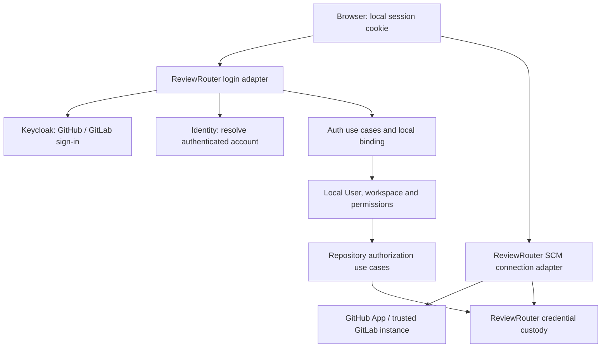

# Unified Identity login and separate SCM connections

Status: proposed implementation plan; documentation only. Plan date: 2026-11-26. Reviewed source snapshot: 2026-11-25 UTC. This document proposes the ReviewRouter side of the new [Identity service](https://github.com/agent-teams-ai/identity). It does not claim that the service, contracts, migration, deployment, or runtime qualification already exists.

## 1. Decision and intended experience

Keep the existing auth feature, local users, workspace authorization, and SCM integrations. Put central login behind the existing intended auth boundary, give ReviewRouter a stable local principal, and make GitHub/GitLab repository connections independent of the provider used for the latest sign-in. This needs a bounded refactor and an adapter; replacing the application framework or rebuilding repository access would add migration risk without resolving an additional requirement.

The intended experience is:

1. The sign-in page offers **Continue with GitHub** and **Continue with GitLab**. Each starts the configured central OIDC client and requests the matching Keycloak broker. There is no intermediate Google account requirement. An existing central session can satisfy sign-in; the selected button is a routing preference, not proof that fresh GitHub/GitLab authentication occurred.
2. Identity resolves the authenticated central subject to its stable, opaque account reference. ReviewRouter binds that account to a local `User.id` and opens a local application session.
3. Existing, valid ReviewRouter SCM connections work regardless of the most recent sign-in method. A user who signs in with GitLab can use their previously connected GitHub repositories, subject to their current workspace and provider permissions.
4. If a connection is missing, onboarding continues to **Connect GitHub repositories** or **Connect GitLab repositories**. Provider SSO can avoid another password/account-selection step, but separate product consent, GitHub App installation, enterprise SSO approval, or selection of repositories can still be necessary. The UI must distinguish these steps and retain the user's return destination.
5. Canceling optional repository consent leaves the user signed in. Connecting another SCM account does not switch the central account or silently move between workspaces. Central login-method linking lives in Identity; repository connection management lives in ReviewRouter.

This is the smallest useful separation. A new OIDC provider entry alone would leave the dashboard dependent on `sourceProvider === "github"`; moving all provider tokens into Identity would create an unnecessary shared credential service. Neither satisfies the intended ownership model.

### Non-goals

- A global rewrite of Next.js, Auth.js, Prisma, Fastify, workspace authorization, or the model-provider system.
- Automatic account merging, automatic linking by email, cross-product sharing of SCM tokens, or provider-token export through Keycloak administration APIs.
- A new generic auth framework, a new service per port, or a new runtime feature-flag system.
- Migration of historical immutable qualification artifacts, upgrades of unrelated dependencies, and completion of unrelated open PRs.

## 2. Evidence and freshness

The baseline is main commit [`1912bb61b54de8af113e0dccd5d4a144382e19e2`](https://github.com/777genius/review-router-ai/tree/1912bb61b54de8af113e0dccd5d4a144382e19e2). Re-read main, dependency pins, and overlapping PR heads before each implementation phase; the table records observations, not promises about their eventual merge state.

| Evidence at the baseline | Consequence for this plan |
| --- | --- |
| [`auth-options.ts`](https://github.com/777genius/review-router-ai/blob/1912bb61b54de8af113e0dccd5d4a144382e19e2/apps/web/src/auth/auth-options.ts) uses NextAuth JWT sessions, GitHub App credentials, a GitLab OAuth provider, and provider-specific session fields. GitHub sign-in also saves a user authorization. | Separate login completion from product-connection credential persistence. Current sessions are not already durable, centrally revocable application sessions. |
| [`AuthenticatedPrincipal`](https://github.com/777genius/review-router-ai/blob/1912bb61b54de8af113e0dccd5d4a144382e19e2/packages/features/auth/src/domain/authenticated-principal.ts) requires `provider`, `externalUserId`, and `login`. [`dashboard-mutations.ts`](https://github.com/777genius/review-router-ai/blob/1912bb61b54de8af113e0dccd5d4a144382e19e2/apps/web/src/server/dashboard-mutations.ts) looks up the local user from those fields and requires GitHub sign-in for `asDashboardGitHubActor`. | Introduce a local principal at the session boundary and resolve SCM connection authority separately. Extract the touched dashboard auth block instead of growing the existing large file. |
| [`prisma-user-repository.ts`](https://github.com/777genius/review-router-ai/blob/1912bb61b54de8af113e0dccd5d4a144382e19e2/packages/features/auth/src/infrastructure/prisma/prisma-user-repository.ts) preserves identity ownership under a transaction/advisory lock. GitHub users may pre-exist through installation webhook handling. | Preserve concurrency and immutable-ID reconciliation. Keep local IDs and existing assets. Email and login remain profile snapshots, never ownership proofs. |
| [`schema.prisma`](https://github.com/777genius/review-router-ai/blob/1912bb61b54de8af113e0dccd5d4a144382e19e2/packages/platform/db/prisma/schema.prisma) stores external identity uniqueness as `(provider, externalUserId)` and `(userId, provider)`, while GitLab installations/repository connections already carry `sourceBaseUrl`. | Namespace GitLab identities by trusted instance before relying on them for legacy binding. Native user ID `42` on two GitLab instances is two identities. |
| [`github-user-authorization.ts`](https://github.com/777genius/review-router-ai/blob/1912bb61b54de8af113e0dccd5d4a144382e19e2/apps/web/src/server/github-user-authorization.ts) in the web host is a re-export; actual encrypted custody is in [`features/auth`](https://github.com/777genius/review-router-ai/blob/1912bb61b54de8af113e0dccd5d4a144382e19e2/packages/features/auth/src/infrastructure/github/github-user-authorization.ts). [`github-user-repository-access.ts`](https://github.com/777genius/review-router-ai/blob/1912bb61b54de8af113e0dccd5d4a144382e19e2/apps/web/src/server/github-user-repository-access.ts) checks user-visible installations/repositories. | Reuse current custody and repository access. Do not create a second secret store or replace user checks with the broader installation token. |
| [`gitlab-connect.ts`](https://github.com/777genius/review-router-ai/blob/1912bb61b54de8af113e0dccd5d4a144382e19e2/apps/web/src/server/gitlab-connect.ts) accepts a separate setup token. Login requests `read_user`; setup performs API operations such as provisioning variables and a setup MR. | GitLab login does not currently provide repository/setup authority. Add a product connection flow with explicit scopes; preserve a narrowly qualified existing token path where self-hosted OAuth registration is unavailable. |
| [ADR-013](../decisions/013-authjs-behind-auth-ports.md), [auth boundary](../architecture/30-auth-provider-boundary.md), and [session/CSRF design](../architecture/18-auth-sessions-csrf.md) already intend auth ports and framework-independent use cases. | Complete that boundary and add a narrowly scoped successor decision for central identity. Do not rewrite accepted historical ADRs to pretend the migration happened. |

### Overlapping work inspected

| PR and inspected head | Required coordination |
| --- | --- |
| [#1007: multi-tenant reliability](https://github.com/777genius/review-router-ai/pull/1007), `1a71a58ff79a21d95a29349f38a23627620584b5` | Its durable GitHub refresh-attempt/revision fencing, revocation/cache authority, and separation of GitLab setup and review credentials overlap this work directly. Rebase onto the accepted implementation or coordinate a narrow dependency with its owner; do not build a competing refresh state machine. Its [branch plan](https://github.com/777genius/review-router-ai/blob/1a71a58ff79a21d95a29349f38a23627620584b5/ai-docs/plans/2026-11-25-multi-tenant-reliability.md) is candidate evidence, not merged-main behavior. |
| [#998: scoped dashboard/worker/modular qualification](https://github.com/777genius/review-router-ai/pull/998), `5f8bb3ebdc147849857206856b17815bf011116e` | Recheck extracted dashboard locations and Foundation's actually adopted capabilities. Preserve its bounded policy, current artifact evidence, and cleanup semantics. |
| [#1002: full-root Markdown reference adoption](https://github.com/777genius/review-router-ai/pull/1002), `c830f55b14b8e2763f3bf0ab3c7191de8cbda631` | A separate draft, with historical-reference constraints. Validate this document's links; do not silently broaden its exclusion policy or alter immutable receipts to make a full-root check pass. |
| [#959: native provider method parity](https://github.com/777genius/review-router-ai/pull/959), `99507c127ca095a5845dd7411696539c7b4d818a` | Shared manifests and dashboard/provider setup can move. Preserve model-provider account flows and their tests; they are not central identity or SCM grants. |

The remaining open PRs inspected at this cutoff concern projection decoding, observation policy, marketing, or earlier custody work. Their presence is not evidence that this migration is implemented. Implementation must refresh this inventory; source positions and exact package exports can change.

Later observation on 2026-11-26: main remained at the baseline SHA; #1007 advanced to `237c802358396414859366520cbb58fb07450004`. The [comparison from the inspected head](https://github.com/777genius/review-router-ai/compare/1a71a58ff79a21d95a29349f38a23627620584b5...237c802358396414859366520cbb58fb07450004) changes its reliability-plan annotation and Foundation's private usage-retention source classification, with no auth-semantics delta. The other listed PR heads were unchanged. This is a narrow delta check; the table retains the actual source-audit head.

## 3. Boundaries and dependency direction

The diagram separates ownership; it does not prescribe another deployable service. Keep one auth feature and the existing provider-specific infrastructure. Add a module only when it owns a real responsibility or independently changing implementation.

| Concern | Owner and stable boundary |
| --- | --- |
| Login methods, verified central subject links, account lifecycle, recovery policy | Identity and Keycloak. ReviewRouter does not become an account-recovery authority. |
| Product user, workspaces, membership, repository bindings, review history | ReviewRouter, keyed by existing local `User.id`. No foreign key into Identity's database. |
| Local browser session and Identity-account binding | ReviewRouter auth application, with framework-neutral ports and Next/Auth.js/Prisma adapters. |
| GitHub App user authorization, installations, selected repository grants | ReviewRouter. User authorization and installation authorization remain distinct. |
| GitLab API connection, instance trust, provisioning permission | ReviewRouter. Explicitly scoped to the normalized trusted instance and provider's native user ID. |
| Published Identity client/contracts | Used only by ReviewRouter's infrastructure adapter; translate them into local input/result types. No Keycloak or SDK types in local domain/application. |
| Get Modular composition and resource cleanup | Existing host composition. Foundation stays development-only. Extension Foundation and Live Module Updates are not session or durable event transports. |

### Minimal internal changes

Use the existing `packages/features/auth` public boundary. Add only ports that have immediate callers: a session reader/revoker, a local identity-binding repository, and a central account resolver. Retain existing workspace-access and membership ports. Their names should follow the accepted auth ADR where the responsibility matches; do not introduce parallel synonyms for the same operation.

The local authenticated principal should contain `userId`, a stable application `sessionId`/generation, binding reference/revision, the session's issued security epoch, and the current local account/session status. Display name, email, avatar, and last login method may accompany a profile but cannot establish authority. A GitHub-specific use case obtains a separate GitHub connection authority object, including native user ID, app identity, credential revision, and lifecycle status. A GitLab use case obtains its instance-qualified counterpart.

Move provider checks out of `asDashboardGitHubActor` and into a connection resolver with the actual requirement: this local user has an active appropriate GitHub authorization. Keep workspace membership and live provider repository checks at the operation boundary. `assertGatewayReviewActorUnchanged` must compare stable local user/session/binding identity across awaits and, where needed, the relevant connection revision. Re-evaluate session/lease expiry, account state, and the operation's current local/provider permission before the protected commit or external dispatch; equality of identity fields alone does not prove continued authority. Comparing display login or last sign-in provider cannot provide this guarantee.

Do not turn the current `localAdminGithubLogins` override into privilege based on a central display name. Identify whether it is deployed; migrate any retained operator allowance to audited immutable local identity bindings, or reject the configuration until explicitly resolved. Product memberships remain authoritative; sign-in cannot restore a revoked role.

## 4. Login protocol and session design

### Keep credentials specific to their purpose

The following are contract requirements. Symbolic names such as `ResolveSelf`, `identity-api`, `identity.resolve:self`, `identity.status:read`, and `accountRef` align with the Identity plan but remain illustrative until the same reviewed public contract is accepted in both repositories.

| Credential | Intended recipient and purpose | Forbidden substitution |
| --- | --- | --- |
| OIDC ID token for a dedicated confidential ReviewRouter client | Validate the login response, including configured issuer, signature, client audience, expiry, state/nonce binding, and applicable authorized-party rules. | It is not a general Identity API token, ReviewRouter API bearer token, or SCM token. |
| Access token with Identity API audience, narrow self-resolution permission, and an allowlisted ReviewRouter authorized client | The BFF calls Identity's self resolver. Identity derives the authenticated `(issuer, subject)` from the validated token and returns the active stable account reference and revision. | The request cannot choose an arbitrary subject/account to resolve; a client-credentials token cannot impersonate a user through this operation. |
| Separate workload client's Identity API token with `identity.status:read` | Once the service-side status contract is implemented, refresh bounded account-status batches for the server-managed ReviewRouter consumer attachment set. | It cannot create an attachment to an arbitrary account, call human self-resolution as that person, manage their account, or grant product membership. |
| ReviewRouter application session | Protected cookie plus revocable server-side session state authorizes local reads/mutations through the local principal. | The browser does not use the resolver token as a product API credential. A future direct product API bearer flow needs its own audience and contract. |

Use a maintained OIDC implementation with authorization code flow, **mandatory S256 PKCE for the ReviewRouter-to-central-Keycloak profile**, state, nonce, exact registered callbacks, and a local allowlist for return destinations. R0 must prove the pinned library's implementation and reject downgrade; an old adapter default cannot weaken the common protocol. Human BFF clients disable service accounts, password grants, and other unneeded flows; the status workload client is separately classified and cannot call human self-resolution. The OIDC client and upstream broker clients are separate from ReviewRouter's SCM authorization clients. No issuer, discovery endpoint, client ID, or token endpoint is accepted from an arbitrary browser parameter.

The login callback validates the central result, calls the self resolver server-side, and transactionally loads or creates the local binding. Creating a local user is allowed only through the explicit new-account path described in the migration section. A successful login must not leave a half-created user without a binding; parallel callbacks converge through unique constraints. Cache the resulting active-state lease and its revision with the local session. Reject an absent/inactive binding; do not fall back to email or a GitHub login string when Identity is unavailable.

### Default implementation: Auth.js adapter with persisted sessions

Retain the pinned NextAuth integration initially, adding a bounded adapter that maps its account/session operations to the existing local identity and session stores. Use a single central OIDC provider in the sign-in flow. Prefer its database session strategy, as already intended by ADR-013; the current implementation's provider-field JWT cookies are not sufficient for immediate local revocation.

The R0 spike must verify that the exact installed library can preserve existing `User.id`, use the central resolver before provisioning, reject unsafe account linking, and persist a revocable session without leaking credentials. Do not simply install a generic Prisma adapter over the existing `User` table: its default user creation, email matching, account linking, and token-storage behavior must be controlled by the local invariants. If the pinned version cannot satisfy these requirements without reaching into private APIs, record one narrow supported-library upgrade or adapter alternative before R2. Do not ship two competing session systems as a permanent architecture.

Keep access/refresh tokens and any logout ID-token hint only in encrypted server-side adapter state, with bounded retention and separate purpose from SCM custody. Do not expose them through the session callback, client JavaScript, URLs, diagnostics, or application events. Cookies use the appropriate secure, HTTP-only, same-site policy for the actual callback mode. Mutations retain CSRF/origin protection; callback and cookie policy is exercised against the deployed reverse-proxy URL. Scope client data caches to the local user/workspace and clear private cached data on logout or session-identity change; an old browser cache is not authority for the next account.

If the product retains a central refresh token to renew its resolver credential, its session owner must serialize renewal across replicas with a durable claim/generation and fence the result against logout, session revocation, and the issued security epoch. NextAuth configuration alone is not evidence that refresh rotation is implemented. Reuse compatible established transaction mechanics without storing central credentials in a GitHub authorization record. An ambiguous one-use refresh outcome expires that local session and requests sign-in; it must not disable the global account or retry an already-consumed secret indefinitely. A newly refreshed token does not constitute the fresh user authentication required by binding/recovery policy.

## 5. SCM connection flows

### GitHub

Reuse ReviewRouter's existing GitHub App and encrypted user-authorization store. Login no longer calls `saveGitHubUserAuthorizationFromAccount`; an explicit ReviewRouter GitHub connection callback does so after validating its own authorization intent and the native GitHub `/user` identity.

The current NextAuth configuration includes the scope string `read:user user:email repo`, but it uses GitHub App credentials. GitHub App authorization is governed by application permissions and the intersection of user/app/repository access; that string is not evidence of OAuth-App-style repository scopes. Qualify the registration's actual required permissions and remove misleading login/connection coupling when editing the adapter. [GitHub's user-token documentation](https://docs.github.com/en/apps/creating-github-apps/authenticating-with-a-github-app/generating-a-user-access-token-for-a-github-app) and [permission model](https://docs.github.com/en/apps/creating-github-apps/registering-a-github-app/choosing-permissions-for-a-github-app) are the authority for this distinction.

An installed App is not necessarily authorized by the current user; user authorization also does not imply installation on a desired repository. Preserve `/user/installations` and per-installation repository checks, active installation state, repository selection, current local membership, and fresh permission checks before sensitive writes. Preserve App-first publication and existing review-agent credentials. A missing/revoked user grant is a reconnect condition, not permission to retry with an installation token that can see more data.

Adopt #1007's revision/refresh-attempt authority and cache fencing when available. Disconnect, webhook deauthorization, refresh, reconnect, and cache reads must agree on one durable authority. An old refresh result cannot resurrect a revoked authorization, and a late failure from an old generation cannot revoke a new one. Unknown outcomes after a one-use refresh token was consumed require reconnection unless the provider offers a proven recovery mechanism.

### GitLab

The sign-in broker proves identity; the ReviewRouter connection obtains API access from a trusted GitLab instance. Current sign-in's `read_user` permission does not authorize repository inventory or setup. Start with `read_api` if the selected product operation is read-only; request `api` only for the existing provisioning operations that require it. GitLab's `write_repository` permission concerns Git-over-HTTP and must not be mistaken for permission to write project variables or create a merge request. Present the actual broad API permission clearly and limit token retention to the chosen lifecycle. See [GitLab scopes](https://docs.gitlab.com/integration/oauth_provider/) and [OAuth API](https://docs.gitlab.com/api/oauth2/).

Use authorization code plus S256 PKCE/state where the supported GitLab registration permits it, exact callbacks, and a server-side `/user` lookup on the intended instance. Retain the existing setup-token adapter for an explicitly supported self-hosted setup case if OAuth client registration cannot be provisioned; do not present it as a login method. A setup token, a persistent user connection, and the credential later used by CI/review execution are different purposes. Reuse #1007's credential separation; never write the user's broad install token or a shared backend credential into project variables as the review token.

The product connection owns `{provider, instance, nativeUserId, credentialRevision, status, grantedCapabilities}`. Persist only the metadata and credentials needed by an actual supported operation. Do not build a generic token broker or assume all providers share GitHub's refresh semantics. GitLab refresh must also serialize per authorization and fence stale writes; if provider rotation semantics make a response-loss outcome ambiguous, force explicit reconnect.

### One-use continuation and account choice

Use one bounded server-side intent mechanism for flows that actually need it, with an explicit purpose: legacy binding, SCM connection, or reconnect. Let the OIDC library own its normal login protocol state; do not create a parallel implementation of its cryptography.

An intent records the initiating browser/session generation, local user and central binding when known, expected provider/instance/client, allowed destination, expiry, required permission, and expected connection revision. It is consumed atomically, is not transferable between purposes, and cannot be replayed after logout, account switch, expiry, or a completed callback. Claim before external code exchange; retain a terminal outcome if exchange/persistence fails so a repeated browser callback cannot create another grant. Store no raw token in browser state.

Provider SSO and a login hint improve navigation only. The callback's validated native identity is the proof. A legacy-binding flow must match the expected existing identity exactly. A normal connection may connect another explicitly selected account only if the product supports that case, no immutable ownership constraint conflicts, and the user confirms the intended account; it cannot silently rebind an existing legacy identity or central account. Initially retain the existing single-GitHub-identity-per-user invariant. Expanding to multiple GitHub accounts is a separate product decision, not an incidental side effect of central login.

## 6. Data model and migration

### Additive data changes

Keep `User.id`, workspace IDs, memberships, repository connections, reviews, model-provider accounts, and installation ownership stable. Introduce a local binding with the following semantics, using the accepted public Identity contract rather than guessing its final field names:

| Record | Required semantics |
| --- | --- |
| Identity-account binding | Configured authority ID and verified authority incarnation; opaque central account reference; existing local `User.id`; binding revision; active/suspended/deleted state; synchronization watermark/lease. Unique `(authority, accountRef)` and at most one active binding per local user for that authority. |
| Local application session | Opaque session identifier, local user/binding, expiry, revocation/session generation, issued security epoch, central state lease, and necessary OIDC session correlation for supported logout. Standard adapter records can satisfy this; avoid a second parallel session table. |
| External identity namespace | Trusted, normalized provider instance plus immutable native user ID. Display login/email remain metadata. Global GitHub uses the configured canonical authority; GitLab requires the actual instance. |
| Product-connection metadata | Existing GitHub authorization/installations plus the necessary GitLab connection record. Native identity, purpose/capabilities, credential generation, expiry, and revoked/reauthorization-required state belong here. |
| Lifecycle delivery state | Small inbox/deduplication and per-account version/lease state in ReviewRouter's database, reusing existing reliable-delivery facilities where compatible. A message bus is not required merely to introduce the boundary. |

External central references are not database credentials or permission grants. They must be opaque to ReviewRouter and remain stable through supported Identity broker changes. Do not key product rows directly by Keycloak `sub`; broker realm/issuer migration needs a controlled Identity binding migration, not bulk rewriting product foreign keys. A returned revision is authority data, never a client-writable session update field.

Namespace migration is additive first: add nullable instance data, backfill only where deployment/configuration history establishes the actual GitLab instance, verify uniqueness/collisions, update read/write paths, then enforce non-null and instance-qualified uniqueness. Do not assign `gitlab.com` to every historical row merely because it is today's default. Quarantine ambiguous rows for fresh native-provider proof; a repository's instance alone does not prove which login instance created the user. Only after writers are compatible should `(provider, externalUserId)` and `(userId, provider)` constraints change to the intended namespace-qualified form.

### Existing-user binding paths

1. **An authenticated legacy user starts migration.** Require recent legacy proof and a fresh central login in the same one-use, browser-bound intent. Bind the resulting active central account to that exact local user. A plain long-lived old cookie is not sufficient for a security-sensitive new permanent binding.
2. **A user has no local session.** Complete central login, then offer a ReviewRouter-owned GitHub/GitLab authorization continuation. Validate the native immutable ID on its trusted instance and look up the existing local identity. Bind that owner only after both proofs are bound to the same intent. An upstream hint, email, central profile claim, or presumed Keycloak broker username cannot substitute for this step.
3. **A truly new product user.** Provide an explicit new-account path. If migration lookup has found an existing identity, never bypass it by creating a second user after a conflict. If the person defers legacy proof and chooses a new account, explain that existing workspaces are not imported; a later collision must be handled without automatic merge. Ensure only one binding/user/personal workspace is committed across concurrent first logins.
4. **The central account or local identity is already bound elsewhere.** Return a typed conflict and leave both accounts and their assets unchanged. Existing GitHub and GitLab ReviewRouter users can be two different local users even if the person later links both centrally. Do not merge memberships, subscriptions, secrets, or review histories as a side effect of login. Any future explicit merge/asset-transfer flow needs its own authorization and migration design.

Preserve reconciliation with GitHub installation webhooks: an earlier webhook may have created the local GitHub user. Link to that immutable native-ID owner under the existing transaction discipline. A race with first central login or provider linking must not leave two users or two personal workspaces. No workspace owner role is granted merely by matching an organization/user login string.

### Compatibility and rollback

Use expand, deploy compatible readers/writers, migrate, then contract. Before enabling central login, create a rollback-compatible local session/binding guard release. Document exactly which previous application version can read the additive schema and honor central suspension. The untouched pre-migration binary is not automatically a safe rollback target after central accounts become authoritative.

At cutover, expire or deliberately rotate legacy session cookies and require the chosen proof path. Do not relabel an old provider-field JWT as a centrally authenticated session. If a short overlap is necessary for active migration intents, admit only that purpose; it must not let centrally suspended accounts regain normal access through legacy sign-in. Authentication selection is a deployment configuration with one supported composition, not a hidden per-user fallback flag.

Rollback restores the previously qualified compatible composition and callback configuration while preserving additive binding/session records, local IDs, and tombstones. Never roll back by dropping mappings, copying central tokens into SCM custody, or accepting unvalidated old sessions. If the provider/Identity outage makes safe login impossible, retain the bounded existing-session behavior described below and show a recoverable login error. Account lifecycle safety takes priority over an unrestricted legacy-login fallback.

## 7. Lifecycle, outages, and failure semantics

| Event or failure | Required behavior |
| --- | --- |
| Log out of this ReviewRouter session | Revoke local session first and clear its cookie. A failed central logout redirect must not restore local access. Offer explicit central logout semantics separately. |
| Log out of all ReviewRouter sessions | Revoke all local sessions for the exact local user through the local session owner. This is distinct from global logout and from disconnecting an SCM connection. |
| Canonical global logout through Identity | Revoke the initiating local session first. The central operation commits its security epoch/cutoff before asynchronous provider logout; the local immutable issued epoch and freshness bound invalidate other sessions even when back-channel delivery is missed. Show accepted/pending cleanup honestly; a local write or redirect is not proof that all provider sessions are gone. |
| Verified provider-native single-session/back-channel logout | Revoke only matching local sessions through supported authenticated correlation. Verify logout token issuer/audience/signature/event/replay properties; a browser-supplied `sid` is not authority. A provider-native single-session logout is not the canonical account-wide operation and must not be labeled complete global revocation. |
| Central account suspended/deleted | Apply versioned account state, invalidate sessions/leases and deny new authenticated product work. Retain the minimal deletion/conflict tombstone needed to prevent resurrection. Follow the product's separately documented retention/erasure obligations for reviews and workspace data. |
| Consumer relationship detached centrally | Stop issuing usable status evidence for this consumer through both self and workload paths. Preserve the attachment tombstone and present typed reattachment-required status. A valid old self token cannot renew the lease or silently reattach; require the explicit fresh user-bound intent after the attachment cutoff. This does not merge/delete product users or transfer SCM grants. |
| Lifecycle delivery is late, duplicated, reordered, or unavailable | Idempotent inbox plus per-account monotonic revision prevents an old active event from undoing suspension. Reconcile with an authenticated current-state API before the active lease expires. A fresh login response cannot overwrite a higher known suspension revision. An unexpected authority incarnation closes admission until continuity is reconciled; revisions from unrelated incarnations are not comparable. |
| Suspension and later re-enablement both happen while delivery is unavailable | Compare the session's immutable issued security epoch against current authority. A newly active account state does not revive sessions from before the security cutoff. Do not advance the session's epoch merely by refreshing a token or lease; require authenticated `auth_time` and the agreed assurance after the cutoff, even if a Keycloak SSO session remains during asynchronous logout. Token `iat` is not fresh user authentication. |
| Identity outage | Existing sessions may continue only within an agreed finite active-state lease. At expiry, deny protected reads/mutations until current authority is established. Do not keep extending from local activity or stale cache. Login, binding, unlinking, and sensitive connection changes fail closed when their required proof is unavailable. |
| SCM disconnected or provider token revoked | Invalidate only that product connection, its caches, and pending intents. Central login can remain valid. Do not unlink a central login method implicitly or remove a shared workspace installation because one user disconnected. |
| Last central login/recovery method removed | Identity enforces its recovery invariant and step-up policy. ReviewRouter redirects to that managed flow; it cannot recover the central account from an SCM token or a matching email. |
| Self-hosted GitLab changes owner or becomes unavailable | Connection availability and the corresponding scoped broker trust change. A corporate/self-hosted GitLab must not silently become a universal recovery authority for unrelated products or personal identities. |
| Native authorization completes after logout, account switch, or suspension | Fence against the current session/binding/connection generation before applying its local result. Reject and dispose of credentials securely; do not attach them to the new browser user. |
| Provider 401/403, rate limit, or network timeout | Distinguish revoked authorization, insufficient rights, temporary failure, and unknown refresh outcome. Avoid permanent revocation from an old generation's late response. Return a clear reconnect/retry/request-access action without leaking repository existence across workspaces. |

The Identity plan proposes a maximum stale-authority interval of **60 seconds, including clock-skew allowance**, subject to its P0 policy and capacity qualification. Carry that same candidate into R0; select a stricter requirement for binding, recovery, administrative, and credential-changing operations. A lease deadline derives from the original authoritative observation and is additionally bounded by the requesting consumer's recorded request-start time plus the admitted interval; receiving a delayed reply must never restart that timer. Token validity or an earlier server deadline can only shorten acceptance. An event subscription alone provides no bound. Clock regression, restart without trustworthy lease continuity, and uncertain restore invalidate evidence. Test both a delayed active response after suspension and the exact expiry boundary with a controlled clock. The proposed number is not an implemented revocation guarantee.

The initial implementation refreshes status through the self API using that user's valid server-held token. The planned batch/feed contract uses a **separate workload client**, audience `identity-api`, and narrow `identity.status:read` scope. Identity maps that client to a server-managed `consumerId`; neither a request parameter nor the account reference can choose another consumer. Identity records a minimal initial consumer attachment only from validated user self-resolution or an explicitly user-bound attach operation. The workload credential cannot attach arbitrary accounts. A detached relation remains tombstoned: **both self and batch status evidence require a live attachment**. An ordinary self refresh returns typed reattachment-required/denial without a renewable lease; only the explicit fresh attachment intent after its cutoff can restore the relationship. This recipient set authorizes status/event routing only and grants no ReviewRouter membership or asset access.

R0 must agree that same attachment/status contract with Identity; implement batching only after its P4 contract is available and qualified. Batches are bounded and restricted to the consumer's admitted account set; unknown/unattached references receive nonenumerating denial. Events use the same recipient restriction. ReviewRouter still looks up its own local binding and does not provision a user or workspace from an event. Do not silently turn a self-resolution token or a generic service credential into an account-directory API.

Central account suspension blocks new user-authorized operations and revalidates queued work that depends on that user's grant before dispatch. It does not automatically uninstall an organization's shared GitHub App or erase another member's review job. Define which existing jobs run under workspace/service authority and which require a live user grant, preserving the existing agent protocol and avoiding a cross-tenant shutdown. Effects already accepted by an external provider cannot be retroactively canceled; capture that limit in the audit trail.

Keep security telemetry free of tokens, codes, secrets, raw callback query strings, and unnecessary identity data. Record purpose, outcome, local user/workspace, authority/connection revision, correlation ID, and safe error class. Use existing encryption/key-rotation and secret-scanning patterns; central client secrets and SCM encryption material remain separate operational responsibilities. Public callback handlers have bounded input size, request timeout/rate limits, and a closed set of trusted issuers/instances; trusted self-hosted URLs require an operator-reviewed egress policy to address private-network/redirect abuse.

## 8. Implementation phases and file map

Each phase is an independently reviewable change with real consumers. Do not pre-create unused adapters or a directory tree for hypothetical features. Update the source map after overlapping PRs merge.

### R0 — Qualify the seam and agree the cross-repository contract

1. Refresh main/PR heads and the current package/stack pins. Inspect #1007's merged or accepted authority implementation, #998's dashboard extraction, and the final shared Identity contract.
2. Record a narrowly scoped proposed ADR referencing ADR-013: central login, local principal, product custody, migration proof, and session authority. Agree the account resolver, error categories, account/security/binding revisions, self-only initial refresh, later workload-client/consumer-attachment status contract, recipient-scoped delivery/reconciliation, and bounded freshness policy with Identity's owner.
3. Run a small real OIDC/NextAuth compatibility spike using the pinned library and a disposable Keycloak/PostgreSQL environment. Exercise both requested broker buttons, a missing-email profile, an existing central SSO session, mandatory S256 PKCE with downgrade rejection, the human/workload client grant restrictions, exact callback validation, existing-user binding before provisioning, and local-session revocation. Qualify the chosen server-side session adapter; use maintained public APIs.
4. Capture the actual GitHub App registration permissions and supported GitLab instances/scopes. Determine legacy instance attribution and whether login-string operator overrides are deployed. Do not require production secrets in the test environment.

Exit: a concrete contract/version candidate and a supported session-adapter approach, with failures and limitations recorded. A broker button's routing success is not proof of native legacy identity. No subsequent phase relies on an unreleased PR branch as a normal registry dependency.

### R1 — Introduce the stable local principal at real callers

Files: `packages/features/auth/src/domain/authenticated-principal.ts`, auth application ports/use cases, public exports, Prisma user/workspace adapters, `apps/web/src/server/dashboard-mutations.ts`, `dashboard-repository-guards.ts`, `dashboard-repository-access.ts`, and `apps/web/app/layout.tsx`.

1. Add the local session-principal boundary and adapt the existing provider login into it temporarily. Preserve the current immutable-ID lookup and ownership checks.
2. Extract session-to-principal resolution from the already large dashboard module. Keep the framework adapter at the web boundary; use the existing feature public exports rather than imports into another feature's internals.
3. Replace sign-in-provider checks with local user/membership checks plus an explicit connection-authority lookup where needed. Preserve cross-await rechecks and workspace scoping. Retire legacy GitHub-login fallbacks only after all actual callers have a local ID and their migration is covered.
4. Resolve the immutable operator allowance, without broadening its recipients.

Exit: existing GitHub/GitLab behavior still works; a locally authenticated user can consume an existing valid GitHub connection without claiming that their login provider was GitHub. CLI repository-token authorization and agent credentials retain their separate contracts.

### R2 — Add binding, session, and namespace persistence

Files: `packages/platform/db/prisma/schema.prisma`, one or more additive Prisma migrations, auth repository adapters/use cases, existing PostgreSQL auth tests, and the selected session adapter.

1. Add central-account binding and the selected standard-compatible durable session records. Add only required intent/lifecycle delivery fields or tables.
2. Add provider-instance namespaces and write the auditable backfill/quarantine procedure. Enforce reviewed uniqueness with the minimum locking needed for actual competing writers.
3. Implement atomic binding with existing-user/native-ID conflict detection, webhook-first-user reconciliation, and idempotent personal-workspace creation.
4. Rehearse expansion and rollback on a sanitized dataset with legacy GitHub-only users, GitLab users, missing email, duplicate-person users, revoked memberships, and ambiguous instance history. Measure constraints/indexes against actual sizes before choosing migration locking strategy.

Exit: the compatible old and new compositions can read the additive schema; invariants hold under the existing PostgreSQL integration harness; no implicit account merge or role grant is possible.

### R3 — Wire central sign-in and local application sessions

Files: `apps/web/src/auth/auth-options.ts`, `auth-env.ts`, `next-auth.d.ts`, `apps/web/app/api/auth/[...nextauth]/route.ts`, `apps/web/app/auth/signin/page.tsx`, `apps/web/app/github-sign-in-button.tsx`, and the new auth infrastructure/session adapters.

1. Add validated issuer/client/resolver configuration and a dedicated central OIDC provider with mandatory S256 PKCE and the agreed human-client grant restrictions; keep build-time configuration checks consistent with the existing environment pattern.
2. Send the requested broker hint through an allowlisted mapping. Validate the OIDC response, obtain the current central account through the self resolver, and use the local binding use case before issuing a session.
3. Render a token-free local session/profile. Store resolver/OIDC credentials only server-side. Implement any retained central-token refresh at the session owner with durable generation fencing; exercise two replicas and logout during renewal. Preserve safe local callback destinations and redirect/error behavior.
4. Complete explicit new-account and migration-needed states. A failed resolver, expired proof, or binding conflict cannot become a new user by fallback.

Exit: direct GitHub/GitLab sign-in through the central broker works without Google; browser sessions contain no SCM or central API credentials; failures have typed, recoverable UX. Existing centrally bound users retain their local IDs.

### R4 — Separate product connection consent and credential custody

Files: auth GitHub custody adapter, `apps/web/src/server/github-user-authorization.ts`, `github-user-repository-access.ts`, installation callback/webhook adapters, `gitlab-connect.ts`, `apps/web/app/api/dashboard/gitlab/{discover,install}/route.ts`, setup UI, and dedicated connection start/callback adapters.

1. Move GitHub user-grant saving to an explicit product connection callback, retaining current encryption and #1007 authority fencing. Preserve actual App registration/installation semantics.
2. Add resumable GitLab OAuth connection where supported, mapping actual granted scopes to supported operations. Use the existing GitLab gateway; keep provisioning/review credentials separate. Qualify a single fallback adapter only for a real supported self-hosted requirement.
3. Reuse provider SSO where possible and show distinct status/actions for signed-in, connection missing, consent declined, installation missing, repository not selected, and insufficient user permission.
4. Implement disconnect/reconnect with revision-fenced intents/caches. A disconnect is local to the selected connection and does not log the person out centrally or remove other workspace users' access.

Exit: both providers' relevant operations use product-owned credentials; changing central login method does not affect established SCM connections; canceling consent leaves a useful signed-in state.

### R5 — Migrate existing users and apply lifecycle changes

Files: binding/linking use cases and adapters, session revocation, central lifecycle inbox/reconciliation adapter, affected dashboard mutation guards, and product account/settings UX.

1. Implement both existing-user proof paths and typed duplicate-account conflicts. Require recent proof and protect callback intent ownership across browser account switches.
2. Implement authenticated event receipt/deduplication and current-state reconciliation against the agreed contract; persist revisions and enforce the concrete freshness bound. Recheck new/queued user-authorized sensitive operations.
3. Implement local/all-ReviewRouter-session logout, canonical central global logout with epoch/cutoff, scoped back-channel handling, consumer detach/explicit reattachment, suspension/deletion handling, and redirects to central login-method management. Keep recovery responsibility central and distinguish pending provider cleanup from confirmed completion.
4. Run a migration rehearsal and inventory unresolved rows. Record exact compatible rollback version, cookie cutover procedure, provider redirect/client-registration changes, and the behavior of active migration intents during cutover.

Exit: every admitted application session has a resolvable, current-enough authority; lost events cannot extend access forever; linking conflicts preserve existing assets and can be explained without exposing other users' private data.

### R6 — Qualify the complete paths and prepare rollout

1. Run the focused matrix below, affected auth/dashboard/provider tests, typecheck, and the repository's actually adopted architecture/quality checks. Use the current required CI tier; a documentation-only plan does not need runtime environment changes.
2. Recheck dependency/public-export pins and record actual qualification evidence, failures, and supported provider versions. Check local-reference integrity and review the new auth dependency map.
3. Update the auth architecture/session docs, environment setup and incident runbooks, and the canonical index. Add the required per-implementation deployment task and index entry only when runtime work is ready for rollout, following [release management](../operations/07-environments-and-release-management.md). Include backups, migration order, smoke checks, monitoring thresholds, and abort/rollback instructions.
4. Prepare one concrete rollout proposal with an explicit production cutover and owner-controlled provider client changes. This planning PR grants no deployment permission and does not claim any environment is updated.

Exit: the implementation is reviewable, tested at the actual authority boundaries, and reversible through the qualified compatible release. Accepted plan wording alone is not rollout evidence.

## 9. Focused verification

Extend current auth/PostgreSQL/dashboard/provider test harnesses. Use real PostgreSQL for constraints, transaction races, and persistent revocation; real Keycloak plus a controlled upstream provider fixture for the OIDC browser path. A disposable real GitHub/GitLab smoke validates registration/permission differences before rollout when authorized. Fixtures cannot certify production tenant/enterprise policy. Avoid real customer repositories, paid-model calls, or broad provider end-to-end suites unrelated to auth.

| Essential scenario | Assertion and practical level |
| --- | --- |
| Fresh and returning central GitHub/GitLab login, including missing email and existing SSO | Browser integration: no Google requirement, exact configured issuer/audiences, local session, stable local user, no mandatory repeat SCM consent when a valid connection exists. |
| GitLab sign-in with an existing GitHub connection; connection consent canceled | Browser/use-case integration: usable GitHub repository access derives from local user plus valid grant; cancel leaves login intact and no orphan credential. |
| Legacy migration with/without an existing session | PostgreSQL + callback integration: native immutable-ID proof is required, product IDs/memberships remain unchanged, two proofs bind one intent. |
| Equal emails, GitLab native-ID collision across instances, unknown historical instance, existing central/local binding conflict | Boundary/DB tests: no email merge, no cross-instance adoption, typed conflict/quarantine, no personal-workspace duplication or privilege restoration. |
| Wrong issuer/audience/client/actor class, PKCE downgrade, unattached account requested by a status workload client, old valid self token after detach, forged return target, replay, wrong intent purpose, logout/account switch during callback | Protocol/callback integration: no token substitution, unauthorized status disclosure, renewable lease for a detached relation, callback side effect after stale authority, or open redirect. Assert secrets absent from client session and captured logs. |
| Concurrent first login, installation webhook user creation, and link attempts | Existing PostgreSQL concurrency harness: one stable owner and one personal workspace; losing operation reports conflict or converges safely. |
| Revocation during refresh/cache read and late old-generation responses | Reuse/extend #1007's focused GitHub authority tests; current generation cannot be resurrected or revoked by stale work. Exercise the new central session refresh with two replicas and logout, plus the equivalent for a newly introduced GitLab refresh implementation. |
| Suspension with duplicate/out-of-order/missing events, canonical global logout with lost back-channel delivery, and Identity outage | Durable integration with controlled clock: higher revision wins, reconciliation converges, freshness expiry denies protected operations, recovery never extends from a stale active cache. Drop events across both suspend and re-enable or global logout: an old session stays denied by its issued epoch even when the final snapshot is active; surviving SSO/refresh requires actual fresh authentication after the cutoff. |
| Connection revoked/insufficient scope/installation removed/provider timeout | Provider adapter + product authorization integration: correct reconnect/request-access/retry state, no broader-token fallback or cross-workspace disclosure. |
| Migration and compatible rollback rehearsal | Sanitized DB snapshot and selected compatible binary: local IDs survive, sessions follow cookie cutover, additive mappings/tombstones survive, unsafe legacy login is unavailable. |

Add small unit tests only for nontrivial normalizers, capability mappings, and state-transition invariants not covered above. Do not test trivial pass-through wrappers, duplicate provider suites, or set a repository-wide coverage target. A concise matrix of boundary failures is more valuable than hundreds of mocked callback snapshots.

## 10. Stack, Foundation, and public contracts

The inspected ReviewRouter manifests/lock record NextAuth `4.24.15`, Next.js `16.4.6`, Prisma `7.8.0`, TypeScript `7.0.2`, Node `26.11.1`, pnpm `11.28.7`, Engineering Foundation `3.1.0`, stack-toolchain `0.3.1`, and Get Modular Core/Assembly `0.8.0`. The root Prisma/client manifest ranges are `^7.8.0` with locked resolution `7.8.0`; the web client declaration is exact `7.8.0`. These are source observations, not a claim that every manifest uses an exact pin or a recommendation to freeze future versions. [Root package](https://github.com/777genius/review-router-ai/blob/1912bb61b54de8af113e0dccd5d4a144382e19e2/package.json), [web package](https://github.com/777genius/review-router-ai/blob/1912bb61b54de8af113e0dccd5d4a144382e19e2/apps/web/package.json), and [adoption notes](../../architecture/foundation/README.md) record the actual baseline. The new Identity repository must follow the then-current organization stack and all applicable Foundation capabilities from creation; this integration must remain compatible with ReviewRouter's own qualified adoption.

Use stack-toolchain's current published technical-toolchain contract and public presets for the compiler/linter/formatter cohort. It is not the version resolver for NextAuth, Next.js, Prisma, databases, or Keycloak: their consumer manifests, lockfiles, actual compatibility evidence, and applicable organization decisions own those versions. Do not hand-copy an unverified organization-wide version list or force ReviewRouter to replace Prisma just because Identity chooses a different allowed persistence adapter. Exact pins, package exports, release state, and packed-consumer compatibility must be checked at the implementation PR's head.

Extend the repository's real Foundation policy to protect the new auth sources and adapters when those sources exist. Enforce domain/application independence from Next/Auth.js, Prisma, Keycloak, HTTP framework types, and concrete SCM SDKs; give infrastructure/composition explicit ownership. Keep Foundation development-only and Get Modular construction in composition. Adopt applicable new quality/repository checks according to the reviewed organization policy and active RR adoption; record real gaps, not fictional whole-workspace conformance. Do not exclude auth from the new boundary merely to keep a check green.

Consume the Identity SDK's **released, qualified public DTO/client contracts** in one infrastructure adapter. The same reviewed contract version must underpin the Identity plan, resolver, and RR consumer. Never import Identity's internal domain, database schema, Keycloak adapter, Extension Foundation implementation, or a moving PR head into product domain code. If release timing requires a temporary interoperability fixture, label it as a test fixture and gate production use on published compatibility; it is not a substitute SDK shipped silently into runtime.

Current or planned Extension Foundation/Live Module Updates integrations belong behind their actual published host contracts. They must not replace authorization validation, credential custody, account-revocation inboxes, or persisted authority state. Add a ReviewRouter adapter only for a concrete runtime need and after qualification; central-service use of those packages does not require every consumer to depend on them.

## 11. Effort, risks, and decision gates

These are planning ranges after reusing existing custody, #1007's accepted reliability work, and existing test infrastructure. They exclude the central Identity service, upstream library implementation, general account merge, a framework replacement, and unrelated provider work. They are not acceptance criteria or a line-count budget.

| Work | Approximate new/meaningfully changed lines | Main uncertainty |
| --- | ---: | --- |
| Local principal, binding/session adapter, central login and callbacks | 1,400–2,400 | Exact NextAuth adapter lifecycle and published resolver contract |
| Product connection flows, migration UX and lifecycle integration | 1,700–3,100 | GitLab supported instances/scopes and legacy identity attribution |
| Schema/migrations, configuration and runbooks | 350–750 | Existing data quality and final operational freshness policy |
| Focused tests/fixtures, extending current harnesses | 900–1,600 | Availability of reusable Keycloak/provider browser fixtures |

Do not sum this estimate with #1007's entire scope. Some changed lines are extraction or relocation, and R0 may materially narrow or expand the adapter estimate. Confidence in sizing is **4/10** until that spike and the legacy-data inventory complete.

| Assessment | Rating | Reason and limitation |
| --- | ---: | --- |
| Fit with existing Clean Architecture direction | 9/10 | Reuses the accepted ports, local IDs, and provider adapters; actual enforcement still needs the implementation source policy. |
| Migration complexity | 7/10 | The hard part is immutable ownership and independent authority lifecycles, not adding an OIDC provider option. |
| Expected UX simplicity | 8/10 | Direct broker buttons and reuse of valid connections reduce friction; provider consent and enterprise policy remain outside the application's control. |
| Expected security/operational readiness after the listed gates | 8/10 | Depends on verified session handling, bounded lifecycle freshness, successful migration rehearsal, and actual provider registration. This is a design judgment, not a completed audit. |

### Decisions that must be concrete before their phase can exit

- **R0:** Exact published self-resolver/event contract, trusted central authority/client audiences, and a supported pinned session-adapter approach.
- **R2:** Authoritative attribution of existing GitLab identities, duplicate-user handling, and a migration strategy appropriate to actual data size. Ambiguous rows have an explicit quarantine path.
- **R4:** Supported GitLab instances, the operations requiring `api`, and which credential is retained for each purpose. Broad setup access cannot silently become a permanent review credential.
- **R5:** Concrete active-state freshness interval, sensitive-operation policy, authenticated delivery/reconciliation protocol, and local/central logout semantics. A lifecycle event mechanism without a reconciliation bound is insufficient.
- **R6:** Qualified compatible rollback release, provider redirect/client registration readiness, migration rehearsal evidence, and the deployment record required by repository rules.

These are implementation gates, not reasons to leave the planning task incomplete. The adapter and ownership direction is decided here; only facts that require a real library/environment/data check remain qualified.

## 12. Review checklist and primary protocol references

Review the plan in three distinct passes before implementation: source/caller coverage and overlapping work; account takeover/tenant isolation and authority lifecycle; migration/rollback, operational cost, and unnecessary abstractions. Record actual findings and fixes in the planning PR. Do not report the above test matrix as executed runtime evidence for a documentation change.

The document's author pass explicitly corrected the following traps: treating a GitHub App's scope string as its repository permission model; assuming GitLab sign-in supplies setup rights; requiring GitHub sign-in instead of a valid product connection; assigning GitLab native IDs without instance namespacing; replacing local IDs with Keycloak subjects; trusting a broker hint as legacy ownership proof; duplicating #1007's credential authority work; and treating an unmodified pre-migration binary as a safe rollback target.

Use these maintained primary protocol references alongside pinned library source when qualifying the implementation:

- [Keycloak Server Administration Guide](https://www.keycloak.org/docs/latest/server_admin/): broker routing/`kc_idp_hint`, account linking and identity-provider configuration. Qualify against the deployed pinned Keycloak version; `latest` documentation is not a version pin.
- [NextAuth v4 session and adapter options](https://next-auth.js.org/configuration/options): persisted session behavior. The installed library source and compatibility spike determine the actual supported adapter design.
- [NextAuth account-linking guidance](https://next-auth.js.org/faq): arbitrary-provider email linking is unsafe; keep dangerous email auto-linking disabled.
- [GitHub user access tokens](https://docs.github.com/en/apps/creating-github-apps/authenticating-with-a-github-app/generating-a-user-access-token-for-a-github-app) and [acting on behalf of a user](https://docs.github.com/en/apps/creating-github-apps/authenticating-with-a-github-app/authenticating-with-a-github-app-on-behalf-of-a-user): user authorization, App permissions and installation access are separate.
- [GitLab OAuth scopes](https://docs.gitlab.com/integration/oauth_provider/) and [OAuth API](https://docs.gitlab.com/api/oauth2/): scope meanings, authorization-code/PKCE flows and token lifecycle.
- [OAuth 2.0 Security Best Current Practice, RFC 9700](https://www.rfc-editor.org/rfc/rfc9700): authorization-response binding, token audience restrictions, redirect validation and refresh-token security.
