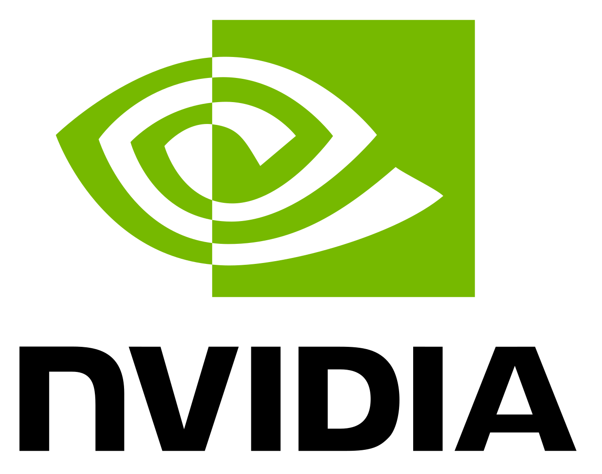

# AI providers and connection methods

[Back to ReviewRouter](../README.md) · [Public providers page](https://reviewrouter.org/providers)

Choose a model provider and connect it with a supported account or API key.
Some methods use a browser sign-in (OAuth), while others require importing
credentials or configuring cloud access.

**Methods listed here are implemented in the native integration.** Your
deployment might enable only a subset. In the dashboard, **Providers → Add
account** shows the connection options actually available to you.

## Claude and Gemini

| Provider                                                                                                                  | How to connect                                                                               | Notes                                                                   |
| ------------------------------------------------------------------------------------------------------------------------- | -------------------------------------------------------------------------------------------- | ----------------------------------------------------------------------- |
|  **Claude (Anthropic)**           | API key; browser sign-in (OAuth); sign-in via session key; setup token via code or cookie    | Subscription sign-in requires the corresponding provider authorization. |
|  **Claude on Amazon Bedrock**    | AWS access credentials (including temporary sessions); Bedrock API key                       | AWS region must be configured.                                          |
|  **Claude on Google Vertex AI** | Google Cloud service-account JSON                                                            | Google project and region are required.                                 |
|  **Gemini (Google)**              | API key; Google One, Code Assist or AI Studio account sign-in                                | AI Studio requires a configured OAuth client.                           |
|  **Gemini on Vertex AI**        | Google Cloud service-account JSON; Vertex API key (project/region or supported express mode) | Express mode depends on the connected profile.                          |

## OpenAI, Codex and other subscriptions

| Provider                                                                                                      | How to connect                                                                                                                                   | Notes                                                                     |
| ------------------------------------------------------------------------------------------------------------- | ------------------------------------------------------------------------------------------------------------------------------------------------ | ------------------------------------------------------------------------- |
|  **OpenAI API**       | OpenAI API key                                                                                                                                   | API billing is separate from a Codex subscription.                        |
|  **Codex**             | Browser or device sign-in; import refresh token, mobile refresh token, `auth.json` or Codex session; Agent Identity; personal access token (PAT) | Imported sessions have different refresh and expiry behavior.             |
|  **Grok**               | API key; browser sign-in; refresh-token import; SSO import                                                                                       | Subscription and SSO options need the corresponding native configuration. |
|  **Antigravity** | Browser sign-in; refresh-token import; API key for an approved endpoint                                                                          | The endpoint must be permitted by the operator.                           |
|  **Kimi**               | Pay-as-you-go API key; Kimi Code plan API key                                                                                                    | Choose the account type that matches your plan.                           |
|  **GLM**                 | Pay-as-you-go API key; GLM Coding Plan API key                                                                                                   | Organization or project details can be required.                          |
|  **MiniMax**         | Pay-as-you-go API key; MiniMax M Plan API key                                                                                                    | Different plans use different connection profiles.                        |

## Other API-key providers

| Provider                                                                                                         | How to connect                   |
| ---------------------------------------------------------------------------------------------------------------- | -------------------------------- |
|  **DeepSeek**          | API key                          |
|  **OpenCode Go / Zen** | Separate API keys for Go and Zen |
|  **Command Code**   | API key                          |
|  **Cline**                | API key                          |
|  **OpenRouter**      | API key                          |
|  **NVIDIA Build**        | API key                          |

 **MiMo Token Plan** also supports a Token Plan API key through ReviewRouter's
existing connection path. It is maintained separately from the native provider
integration.

## What is available now?

There are **two ways to use an AI provider**, and they do not have identical
setup choices:

- **Direct CI:** Configure a supported reviewer workflow with GitHub Actions
  secrets or repository-specific sign-in. See the
  [getting-started guide](https://reviewrouter.org/getting-started).
- **Managed account:** Use **Providers → Add account** to choose from the
  Native/Account Gateway methods enabled for your deployment. Your provider
  credentials remain under protected Gateway custody.

The qualified native integration passed **52 in-scope connection-and-review
scenarios** with controlled provider endpoints, including streaming reviews,
tool continuation, reconnect and credential erasure. This verifies the
integration contract, **not** that each live paid subscription, provider
account, OAuth approval, quota or model will work without additional setup.

The [deployment record](../ai-docs/deployments/2026-11-21-native-provider-parity.md)
documented ten configured native profiles on 27 November 2026. That
environment had not completed live-provider acceptance. A self-hosted
installation may expose a different set of options.

## How the integration stays maintainable

Sub2API owns provider protocols, credentials, refresh and connection methods.
Account Gateway provides account operations; ReviewRouter applies workspace
permissions and review policy. New connection methods that fit existing
contracts can be added and tested in Native without rewriting a different
form for every provider.

Source: [qualified native inventory](https://github.com/agent-teams-ai/sub2api-standalone/blob/9fc45a440eefcad815e16775200407b839419313/backend/internal/gatewaybootstrap/testdata/native_connection_g0_rows.json)
and [joined E2E run](https://github.com/agent-teams-ai/account-gateway/actions/runs/45671137815).
